<div align="center">

# Anota&nbsp;Workbench

**English** | [简体中文](README.zh-CN.md)

**Annotation *interfaces* are a commodity. Annotation *operations* are not.**

Anota is a keyboard-first, self-hosted workbench for **translation quality assessment
and speech transcription review** that bakes the hard part — blind golden sets, append-only audit trails, an LLM
judge you must *calibrate before you trust*, and content-hashed citable exports — straight
into the data model.

**One Python web process · three core dependencies · no frontend build step.**

Start the offline demo below, or use the [Windows guide](docs/local-windows.md).
See the [project map](docs/project-map.md) for the four modules, six frozen studies
and related GitHub repositories.

<br>


[](https://github.com/HenryVarro666/anota/actions/workflows/tests.yml)


[](LICENSE)

</div>

<p align="center">
  <picture>
    <source media="(prefers-color-scheme: dark)" srcset="docs/overview-dark.svg">
    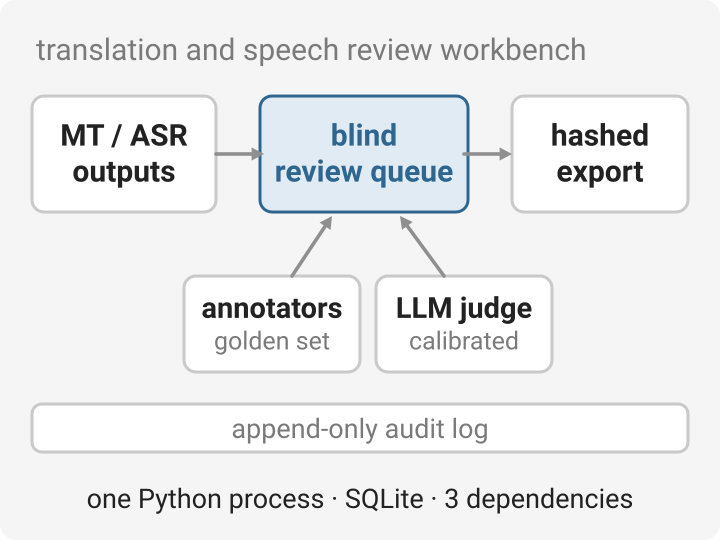
  </picture>
</p>

---

## Quick start

### Run the workbench

**Windows + LM Studio / Ollama:** see the [local Windows guide](docs/local-windows.md).

Use **Python 3.12**, the verified Windows and configured CI version. The core
annotation application targets Python ≥3.10; some speech preparation and experiment
commands use `datetime.UTC` (Python ≥3.11). Full speech/ML support on Python 3.10
is not established.

Windows PowerShell (no environment activation required):

```powershell
py -3.12 -m venv .venv
.\.venv\Scripts\python.exe -m pip install -r requirements.txt -c constraints-runtime.txt
.\.venv\Scripts\python.exe run.py --demo
```

Linux / macOS:

```bash
python3.12 -m venv .venv
.venv/bin/python -m pip install -r requirements.txt -c constraints-runtime.txt
.venv/bin/python run.py --demo
```

Open <http://localhost:8420>.

`--demo` boots a throwaway DB with **30 synthetic EN→ES tasks** (12 planted errors across
three latency arms), a **6-item golden set**, a second annotator's seed labels, and
pre-computed mock-judge verdicts — so every screen has data on first open.

For a persistent database, replace `--demo` with `--db anota.db` using the same
Python executable.

> All bundled demo data is synthetic (EN→ES medication instructions written for this project).
> Bundled fixtures contain **no real patient records**; scale limits are documented
> ([§Limitations](#limitations)).

For a separate local judge server, use one of these commands:

```powershell
# Windows PowerShell
.\.venv\Scripts\python.exe scripts/run_local.py --judge-profile evals/profiles/local-lmstudio.json
```

```bash
# Linux / macOS
.venv/bin/python scripts/run_local.py --judge-profile evals/profiles/local-lmstudio.json
```

Demo verdicts remain labeled mock until a real judge run replaces their latest
view. See the [Windows guide](docs/local-windows.md) for model discovery and the
[project map](docs/project-map.md) for datasets and ASR benchmarks.

RTX 5080 deployment notes (Chinese): [environment preflight and portability](docs/5080-environment-and-portability-2026-10-18.md)
and [CPU/CUDA real-audio acceptance](docs/5080-deployment-2026-10-18.md).
They record a 2026-10-18 source snapshot and a 20-clip FLEURS smoke check;
cluster deployment, production capacity and GPU speedup have not been established.

### Docker

```bash
docker build -t anota .
docker run -p 8420:8420 -v anota-data:/data anota     # persistent DB in a named volume
docker run -p 8420:8420 anota --demo                  # throwaway demo instance
```

The default image runs the CPU web application with its three core dependencies.
It does not install ASR/VAD/ML inference dependencies or include local audio,
`runtime/` data, research evidence or a SpeechRank model bundle. Imported speech
review uses registered audio; optional ML ordering falls back to QC when its
dependencies or bundle are absent. See [portable model deployment](docs/audio-ml-review-queue.md#portable-deployment)
for a separate inference image and external bundle.

Any args after the image name are passed to `run.py`. This PR's
[GitHub Actions checks](https://github.com/HenryVarro666/anota/pull/1/checks)
passed the actual CPU image build, speech review lifecycle and both missing-bundle
and missing-ML-dependency QC fallback paths. The image was tested in CI;
Docker has not been executed on the local Windows machine. These checks do not
establish real ASR inference, an ML-enabled image or an AWS deployment.

---

## Highlights

- **🎧 Real speech review.** A [20-clip English/Chinese speech workflow](docs/speech-smoke.md)
  connects resumable CPU ASR to listening, transcript revisions and traceable exports.
  Speech dependencies are optional and the web process does not load the ASR model.
  Open **Review → Speech review** for ML/QC/original ordering, then claim a clip
  to listen and revise. The [ML queue guide](docs/audio-ml-review-queue.md) explains
  confidence routing, QC fallback, blind order and portable model deployment.

- **🔎 Audio QC and focused replay.** Independent `speechqc` analysis combines DSP,
  Silero VAD and transcript timing coverage. Anota adds a navigable waveform,
  bounded/looped selection playback and clickable review hints. Clean batches receive
  the neutral waveform; machine hints are removed by the server. See the
  [design, usage and human-study plan](docs/audio-qc-v1.md),
  [frozen 66-case engineering experiment](evals/runs/2026-10-17-audio-qc-v1/RESULTS.md)
  and [integration validation](evals/reviews/audio-qc-v1-integration.md).

- **🕵️ Blind by construction.** For golden-collection batches, judge/lint hints are *stripped
  from the JSON on the wire* — not hidden with CSS. A test fails if a clean claim response ever
  leaks a suggestion field. Anchoring bias can't sneak in through DevTools.
- **⚖️ A judge you calibrate before you trust.** Synthetic perturbations with assigned reference labels
  supply a reproducible pilot for per-type recall and false alarms. A real Qwen3-14B
  run on a Radeon 890M includes **raw responses, timing, reference-label disagreements
  and model hashes**. Synthetic reference labels still need expert review.
- **🔌 Provider-agnostic judge.** GPT, Gemini, or a self-hosted vLLM/Ollama — the judge speaks
  the OpenAI Chat Completions protocol, so you swap models with **two env vars**; self-host and
  the content never leaves your boundary.
- **🧾 Append-only, fully audited.** Corrections and undo create *new* rows (latest-wins);
  every claim / submit / undo / lease-reap / review is an audit entry. Annotation
  and audit history is preserved.
- **📐 Agreement math from scratch.** Hand-written Cohen's κ (plain + linear-weighted) pinned
  to textbook values in tests (0.4 on the 2×2, −1.0 on an adjacent-category swap). No sklearn.
- **📊 Error-type × latency-arm analysis.** A matrix that helps investigate
  the real question for simultaneous translation: *what does low latency cost you in dropped
  negations and numbers?*
- **⚡ Small CPU application.** Direct Python startup, port 8420, the application runs inside a
  local development environment. The regression suite covers annotation and judge failures.

<div align="center">

### Dashboard — quality operations at a glance

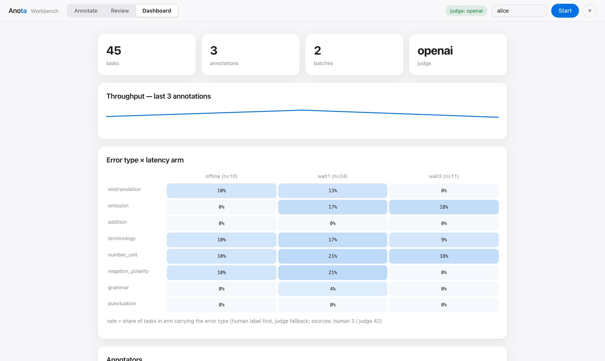

</div>

<details>
<summary><b>Table of contents</b></summary>

Local evidence: [Experiment 03](#experiment-03-one-severity-rule-a-new-test-set) · [Experiment 02](#experiment-02-frozen-holdout-comparison) · [Original pilot](#measured-on-a-radeon-890m)

1. [Quick start](#quick-start) · [Docker](#docker)
2. [Architecture at a glance](#architecture-at-a-glance)
3. [Core ideas](#core-ideas)
4. [The annotation loop, end to end](#the-annotation-loop-end-to-end)
5. [Keyboard reference](#keyboard-reference)
6. [Concepts & data model](#concepts--data-model)
7. [Annotation schema & validation](#annotation-schema--validation)
8. [The judge, calibrated](#the-judge-calibrated)
9. [Screens](#screens)
10. Reference (collapsed): [Importing](#importing-your-own-data) · [Configuration](#configuration) · [HTTP API](#http-api) · [Exports](#exports) · [Project layout](#project-layout) · [Development](#development)
11. [Research evidence](#research-evidence) · [Project map](docs/project-map.md)
12. [Limitations](#limitations) · [Roadmap](#roadmap)

</details>

---

## Architecture at a glance

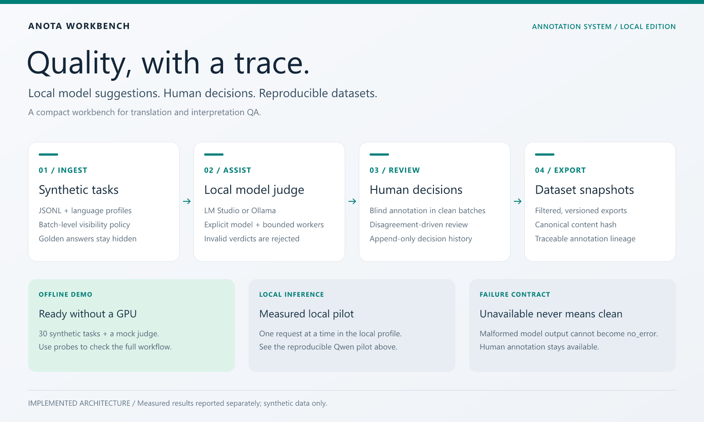

Editable [SVG](docs/figures/local-architecture.svg); regenerate with
`python scripts/render_readme_figure.py` (optional PNG dependency: `resvg-py`).

One FastAPI process over stdlib `sqlite3` (one connection, one lock, no ORM — [on
purpose](docs/DESIGN.md)). Lint runs once at import; the judge subsystem feeds routing and
calibration but never blocks human annotation.

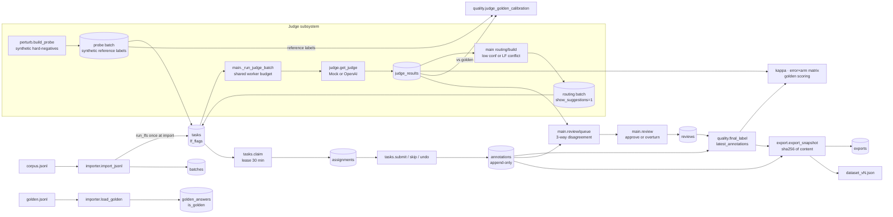

<details>
<summary>Module &amp; table map (one process, 13 application tables, 4 no-build JS files)</summary>

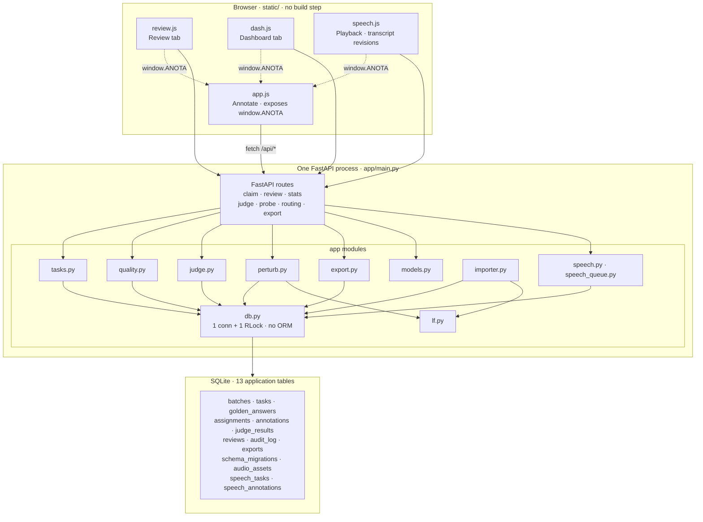

</details>

---

## Core ideas

Anota's thesis: *annotation interfaces are a commodity; annotation **operations** are not.*
Five disciplines are enforced as **system behavior**, not team convention:

| # | Discipline | What makes it real |
|---|---|---|
| 1 | **Anchoring policy is server-side** | `show_suggestions` is a column on `batches`; a clean batch's claim response *does not contain* judge/lint fields at all — stripped from the wire, not hidden by CSS. |
| 2 | **Golden sets are blind by schema** | Honeypot answers live in a server-only table; no annotator-facing payload ever includes `is_golden` or the answer. |
| 3 | **Labels are append-only** | Corrections and undo create new rows (latest-wins); reviewer overrides layer on top; every transition is audited. |
| 4 | **The judge is a first-pass filter** | Verdicts route work and rank review queues; humans adjudicate. If the judge is down, annotation is untouched. A deterministic `MockJudge` keeps demos/CI reproducible offline. |
| 5 | **Exports are citable** | Snapshots are canonical-JSON, content-hashed (sha256), versioned (`dataset@vN`) — identical data always hashes identically. |

Full reasoning for each decision: **[docs/DESIGN.md](docs/DESIGN.md)** (also covers how Anota
compares to Label Studio / Argilla / Prodigy / Scale, deployment economics, and the roadmap).

---

## The annotation loop, end to end

The 5-minute path through the whole closed loop:

| # | Step | What happens |
|---|---|---|
| 1 | **Annotate** | Enter an id, press **Start**. A clean record is two keystrokes (`0` then `Space`). This batch shows **no machine hints** — it collects golden labels (idea #1). |
| 2 | **Dashboard** | The error-type × latency-arm matrix shows what the low-latency arm costs; annotator table tracks golden accuracy + pace; κ panels track inter-annotator and judge–human agreement. |
| 3 | **Probe & calibrate** | *Build judge probe* → synthetic errors with provisional reference labels; *run judge* (pooled, live progress); the calibration card fills in per-type recall and false-alarm rates. |
| 4 | **Route** | *Build routing batch* from lowest judge confidence, then **annotate** it — claims now carry judge + lint chips (labeled `MOCK` when the mock judge produced them). |
| 5 | **Review** | The queue ranks human/judge/lint disagreement first. Open an item for the three-way comparison; **Approve** or **Overturn** with a case note — the raw material for the next guideline version. |
| 6 | **Export** | A content-hashed, versioned snapshot lands in `exports/`. |

---

## Keyboard reference

Active on the Annotate tab (except in text fields; `Esc` leaves a text field).

| Key | Action | Key | Action |
|---|---|---|---|
| `1–5` | adequacy rating | `Space` | save & claim next |
| `⇧1–5` | fluency rating | `u` | undo last submit (prior row kept — append-only) |
| `v` | cycle severity (neutral → minor → major → critical) | `s` | skip |
| `0` | no_error (exclusive; sets neutral + ratings 5) | `c` / `x` | focus correction / note field |
| `m o a t n g r p` | toggle error type | `?` / `Esc` | guideline modal / leave field |

`m o a t n g r p` = mistranslation, omission, addition, terminology, number_unit,
negation_polarity, grammar, punctuation.

---

## Concepts & data model

Thirteen application tables: nine translation/core tables, one migration registry
and three speech tables (excluding SQLite internal tables).

| Table | Role | Design notes |
|---|---|---|
| `batches` | unit of policy | `show_suggestions` (anchoring policy), `overlap` (annotators per task), `guideline_version`, `lang_profile` |
| `tasks` | source / hypothesis / reference + metadata | lint results embedded as `lf_flags`; `metadata.arm` powers the latency matrix |
| `golden_answers` | honeypot truth | **server-only**; never serialized to annotator paths |
| `assignments` | the mutable state machine | claim → 30-min lease → submitted/skipped; expired leases are reaped (audited) and the task returns to the pool |
| `annotations` | labels | **append-only**; latest row per (task, annotator) wins |
| `reviews` | adjudication | approve / overturn (+ replacement annotation row by `reviewer:<id>`) |
| `judge_results` | LLM verdicts | verdict JSON + confidence + `is_mock` flag |
| `audit_log` | everything | append-only record of claim/submit/skip/undo/reap/review/import/export |
| `exports` | snapshot registry | version, filters, sha256, path |
| `schema_migrations` | additive migration registry | translation databases gain speech support in place |
| `audio_assets` | registered audio | path is server-only; bytes are verified against SHA256 |
| `speech_tasks` | speech provenance | links a task to audio and persisted ASR/QC evidence |
| `speech_annotations` | transcript revisions | append-only corrections and review/playback context |

The task lifecycle — the correctness-critical part of the backend, all under one lock:

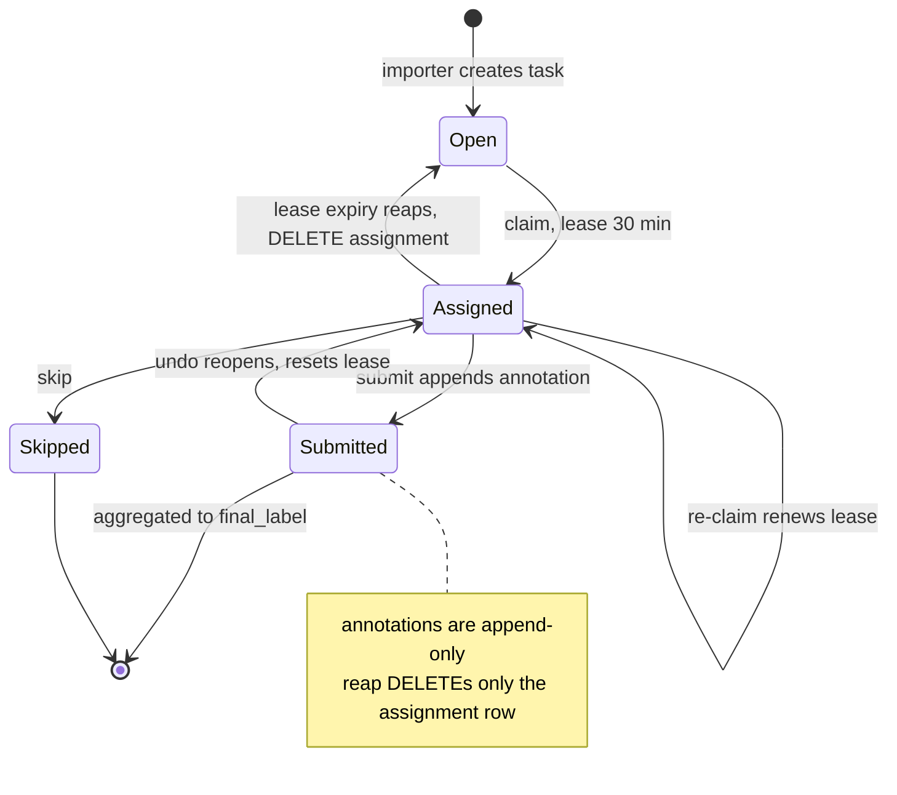

**Distribution semantics:** an annotator never receives the same task twice after submitting or
skipping it; a task is claimable while fewer than `overlap` other annotators hold or have
submitted it. **Final label resolution** (used by exports, the matrix, agreement stats):
reviewer overturn wins; else a single annotator's latest row; else a strict-majority aggregate.
Aggregates with no majority are flagged `unresolved` and **quarantined** from κ and matrix
statistics rather than silently coerced.

---

## Annotation schema & validation

- **Error types (9):** `no_error, mistranslation, omission, addition, terminology, number_unit,
  negation_polarity, grammar, punctuation` — an MQM-derived set, with the three medical-critical
  categories (dosage numbers, negation, terminology) promoted to first-class labels.
- **Severity:** `neutral / minor / major / critical` (project weights 0/1/5/25).
- **Ratings:** adequacy and fluency, 1–5.
- **Rules enforced server-side** (and mirrored client-side so annotators never round-trip to
  learn them): `no_error` is exclusive and forces severity neutral; a real error can never be
  severity neutral; `critical` requires a non-empty evidence note.
- The guideline (`data/guideline.md`) renders in the `?` modal **and** is injected into the
  judge's system prompt — one rubric, single source of truth for humans and models.

**Built-in lint (labeling functions)** — four deterministic checks run once at import, per
language profile (`en-es`, `zh-en`), attached to tasks as evidence-carrying flags; shown to
reviewers and routing, hidden from clean-batch annotators:

| LF | Catches | Notes |
|---|---|---|
| `lf_negation_drop` | source negation with no target counterpart | handles English contractions (`don't`) |
| `lf_number_mismatch` | dropped/changed numbers | language-scoped numeral lexicons: zh compound 二十→20, es `once`=11, en `twice`=2 |
| `lf_untranslated_fragment` | copied-through source spans / CJK residue | |
| `lf_length_ratio` | truncation / over-generation | per-language bounds; abstains on short sources |

---

## The judge, calibrated

The judge is treated as an **uncalibrated instrument until proven otherwise**. *Build judge
probe* creates a batch of **synthetic hard negatives with intended error labels** — clean demo
translations programmatically perturbed (negation injected, first number ×10, a domain term
swapped, a trailing clause dropped) plus unmodified controls. Because the injected error *is*
the intended label, probe items feed the judge-vs-golden calibration card automatically:
per-error-type recall, false-alarm rate on clean items, and κ against the synthetic
references. Expert review is still needed to validate category and severity labels.

The [measured local pilot](evals/runs/2026-10-17-lmstudio-qwen3-14b-q4km/report.md)
uses **Qwen3-14B Q4_K_M, LM Studio / Vulkan, reasoning disabled**, on 20 unique
synthetic examples (11 parent templates), repeated twice. It publishes every raw
response and disagreement. The earlier vLLM figures and screenshots used a different
protocol with a duplicate control; they are historical UI illustrations, not a
comparable baseline. Current claims are backed by the committed run artifacts.

<div align="center">

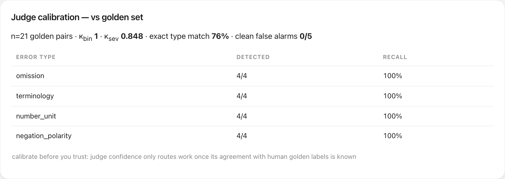

</div>

That contrast (lint-bound MockJudge vs semantic LLM judge) is the point of the card:
**calibrate before you trust** the judge's confidence for routing. Judge failure never breaks
annotation — the top-bar badge degrades and humans keep working. Runs share a configurable
worker budget (local profile: one) and can run in the background with live `done/total` progress.

---

## Screens

| Annotate (light) | Review & adjudication (dark) |
|---|---|
| 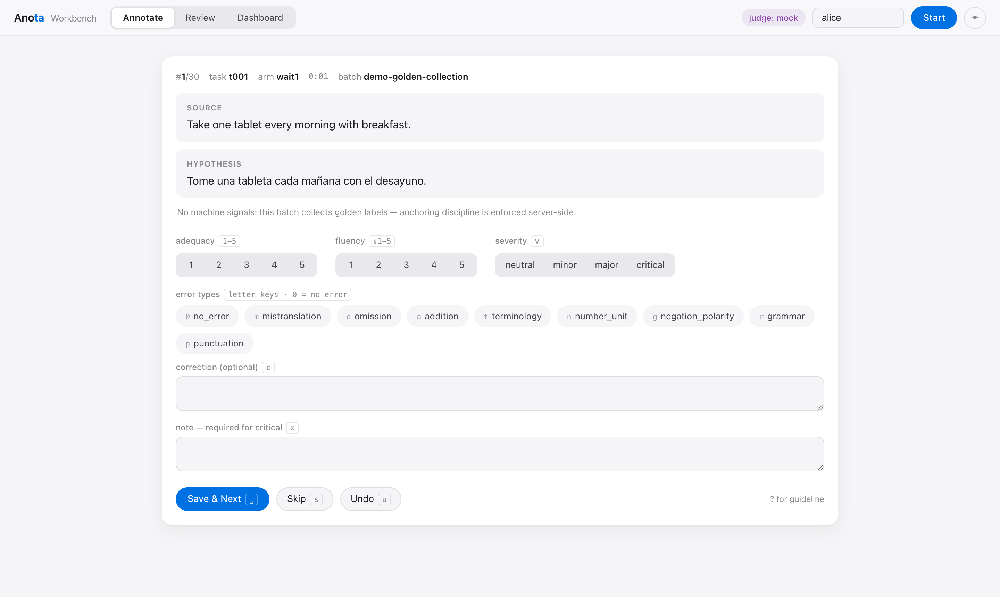 | 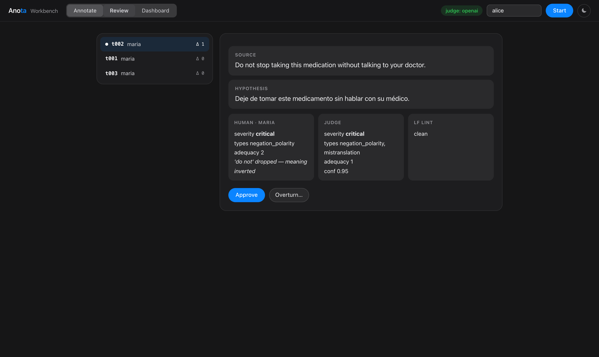 |

Keyboard-first annotation with the anchoring notice ("this batch collects golden labels"); and
the three-way Human · Judge · LF-Lint comparison that ranks disagreement first for the reviewer.
The UI follows system light/dark with an override cycle.

---

## Research evidence

These frozen studies retain their original protocols, results and limitations.
They measure different questions and datasets; their results are not one trend line.
The [project map](docs/project-map.md#six-frozen-studies) indexes all six studies.

<details>
<summary><b>Translation judge: original pilot and two rubric comparisons</b></summary>

<!-- SEVERITY_V3_START -->
## Experiment 03: one severity rule, a new test set

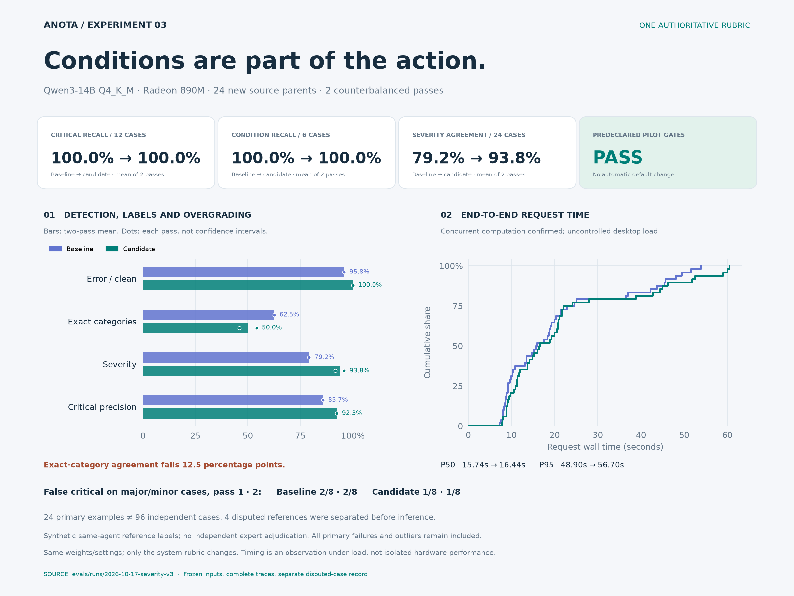

**24 new primary texts · four predeclared disputed texts · two counterbalanced primary passes.**
The candidate replaces the system rubric with one ordered policy: changed clinical action or its prerequisite → critical; other meaning change → major; form-only error → minor; correct translation → neutral. The baseline retains the original rubric. All other request settings are identical.

| Metric | Baseline: passes 1 · 2 | Candidate: passes 1 · 2 |
|---|---:|---:|
| Valid output | 24/24 · 24/24 | 24/24 · 24/24 |
| Critical recall | 12/12 · 12/12 | 12/12 · 12/12 |
| Clinical-condition critical recall | 6/6 · 6/6 | 6/6 · 6/6 |
| Severity agreement | 19/24 · 19/24 | 22/24 · 23/24 |
| Exact category set | 15/24 · 15/24 | 13/24 · 11/24 |
| False critical on major/minor errors | 2/8 · 2/8 | 1/8 · 1/8 |
| False alarms on clean controls | 0/4 · 0/4 | 0/4 · 0/4 |
| Pooled request P50 / P95 | 15.74 / 48.90 s | 16.44 / 56.70 s |

**PASS: all predeclared pilot gates passed in both passes.** The default is unchanged; independent bilingual/domain reference review is still needed.

**Category tradeoff:** mean exact type-set agreement falls by 12.5 percentage points. Passing the severity pilot gates would not establish full taxonomy quality.

**Known critical regression, h19:** previous candidate `omission / major` → severity-v3 `omission / critical`. This missing clinical prerequisite was used to design the rule. Its single follow-up is development evidence, not a held-out gain; the original critical reference is unchanged.

The 96 primary calls represent 24 synthetic source parents. Reference labels and the rubric were authored by the same agent before inference. Four disputed cases have no single gold and are reported separately, never silently removed after seeing predictions. Previous rounds and their labels remain intact; their different datasets are not a direct trend line.

[Full report and every undergrade](evals/runs/2026-10-17-severity-v3/report.md) · [Raw evidence](evals/runs/2026-10-17-severity-v3/attempts.jsonl) · [Unified rule](data/guidelines/severity-v3.md) · [Dispute register](evals/reviews/disputed-labels-v3.md) · [Protocol](evals/severity-v3-protocol.md)

<details><summary>Ordered severity rule, complete case map and editable figures</summary>

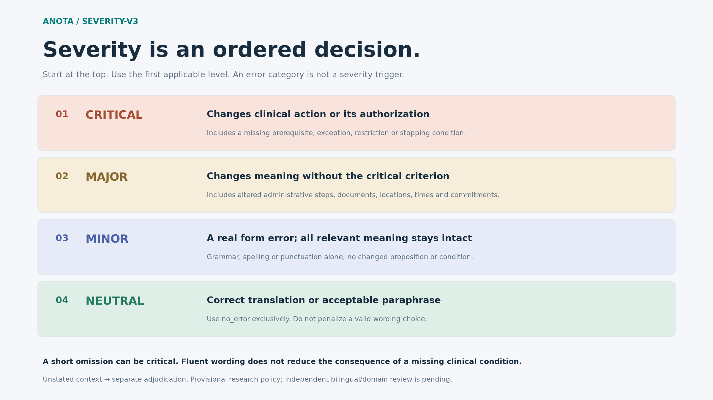

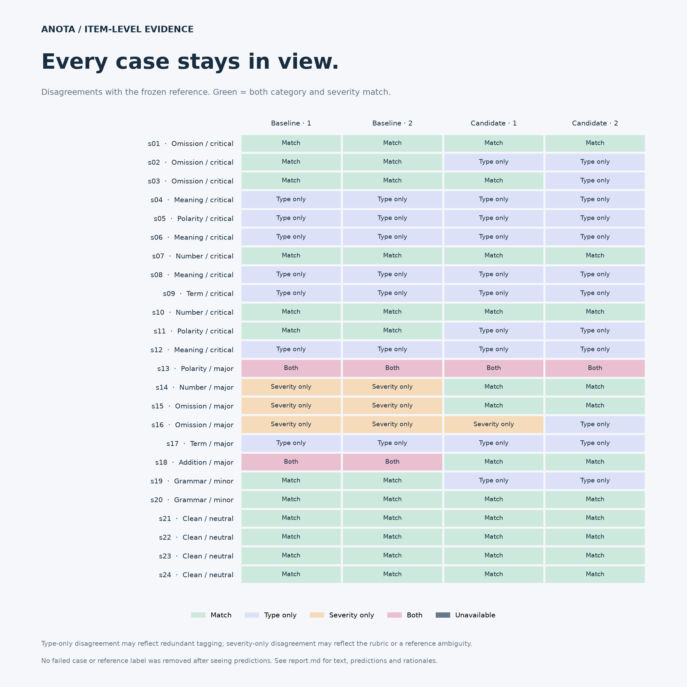

[Comparison SVG](evals/runs/2026-10-17-severity-v3/figures/severity-comparison.svg) · [Policy SVG](evals/runs/2026-10-17-severity-v3/figures/severity-policy.svg) · [Case-map SVG](evals/runs/2026-10-17-severity-v3/figures/case-map.svg)

</details>

[Validation and scope](evals/runs/2026-10-17-severity-v3/validation.json). Windows CPU checks are recorded separately from actual model calls. H100, AWS, Docker and cross-platform CI are not measured by this experiment.

**Timing context:** the user [confirmed concurrent computation](evals/runs/2026-10-17-severity-v3/validation/user-load-context.json). Workload duration and intensity were not logged. All outliers remain included; the latency gate is descriptive and does not establish isolated prompt or 890M performance.

[Interpretation, historical regressions and remaining label questions](evals/runs/2026-10-17-severity-v3/interpretation.md).

<!-- SEVERITY_V3_END -->

<!-- COMPARISON_V2_START -->
## Experiment 02: frozen holdout comparison

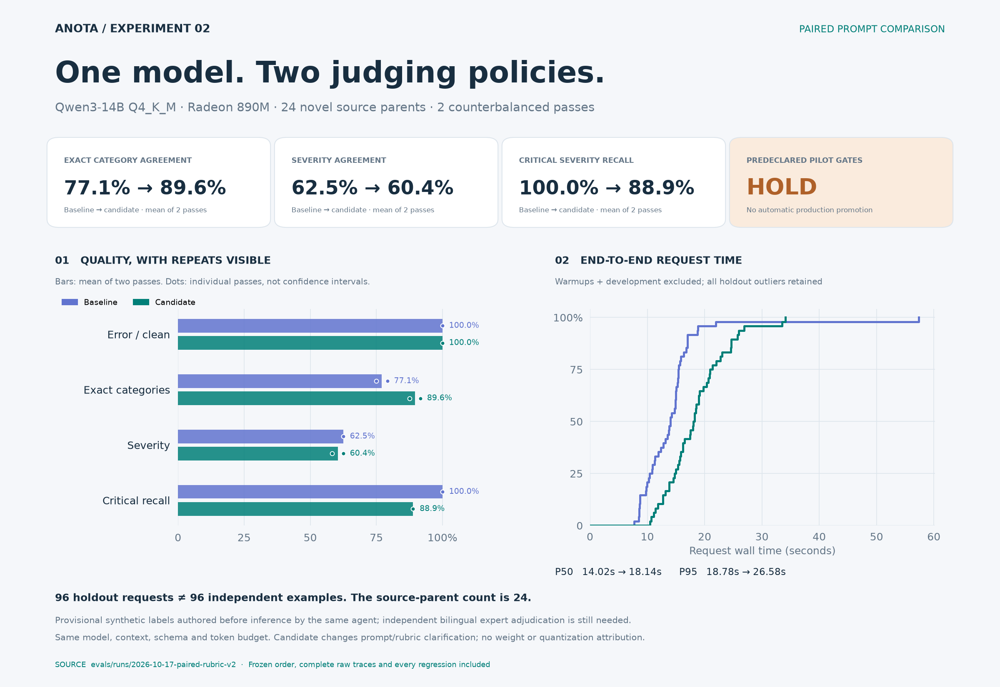

**24 new EN→ES source parents · two counterbalanced passes · identical Qwen3-14B Q4_K_M weights.**
The candidate changes only the prompt suffix: proposition checks, minimal specific labels and consequence-based severity.
Both arms see the same items; original baseline artifacts and labels remain intact.

| Metric | Baseline: passes 1 / 2 | Candidate: passes 1 / 2 |
|---|---:|---:|
| Valid responses | 24/24 · 24/24 | 24/24 · 24/24 |
| Error / clean agreement | 24/24 · 24/24 | 24/24 · 24/24 |
| Exact type-set agreement | 19/24 · 18/24 | 21/24 · 22/24 |
| Severity agreement | 15/24 · 15/24 | 14/24 · 15/24 |
| Critical severity recall | 9/9 · 9/9 | 8/9 · 8/9 |
| Clean false alarms | 0/4 · 0/4 | 0/4 · 0/4 |
| Pooled request P50 / P95 | 14.02 / 18.78 s | 18.14 / 26.58 s |

**HOLD: the candidate did not pass all predeclared gates. The baseline remains the default.**

The exploratory revisit detects both earlier misses (a missing time span and medication→supplement), but still grades both minor. On the new holdout, a missing clinical-action prerequisite is downgraded from critical to major in both candidate passes.

Exact-label gains may come from a clearer annotation convention, not improved semantic detection. Severity references are provisional.
The same agent authored the new texts, reference labels and candidate before inference; independent bilingual adjudication is still needed.
The 96 holdout calls represent **24 source parents**, not 96 independent examples. All regressions and latency outliers are retained.

[Full report, paired wins/losses and regressions](evals/runs/2026-10-17-paired-rubric-v2/report.md) · [raw attempts](evals/runs/2026-10-17-paired-rubric-v2/attempts.jsonl) · [frozen protocol](evals/comparison-v2.md) · [label diagnosis](evals/reviews/pilot-v1-audit.md) · [interpretation and next experiment](evals/reviews/paired-v2-interpretation.md)

A [two-reviewer blind batch](evals/reviews/blind-review.md) can be prepared without provisional gold or model suggestions.
This prompt experiment leaves the system rubric and default model profile unchanged; candidate selection is explicit.

Validation at the frozen evaluation checkpoint: **130 Windows tests passed**. See [validation evidence](evals/runs/2026-10-17-paired-rubric-v2/validation.json) for scope and later checks. Linux/ARM64 CI, Docker, H100 and AWS remain unexecuted here.

<details><summary>Item-by-item comparison and editable figures</summary>

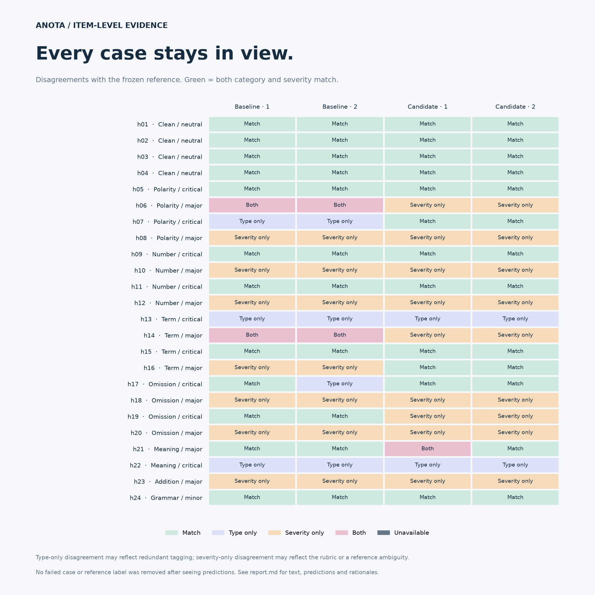

[Overview SVG](evals/runs/2026-10-17-paired-rubric-v2/figures/comparison.svg) · [Case-map SVG](evals/runs/2026-10-17-paired-rubric-v2/figures/case-map.svg)

</details>

<!-- COMPARISON_V2_END -->

### Measured on a Radeon 890M

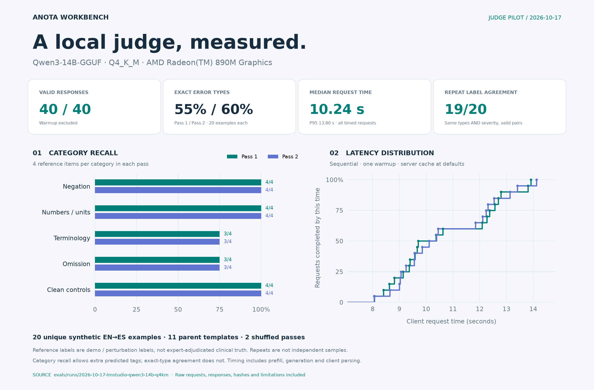

**2026-10-17 · Ryzen AI 9 HX 370 · Qwen3-14B Q4_K_M · LM Studio 0.4.21 / Vulkan.**
One warmup, then two shuffled passes over 20 unique synthetic EN→ES examples from
11 parent templates. One request at a time, 4096 context, JSON schema, `/no_think`.
This is a real inference pilot with synthetic reference labels, not clinical validation.

| Observed metric | Pass 1 | Pass 2 |
|---|---:|---:|
| Valid responses | 20/20 | 20/20 |
| Error vs clean agreement | 18/20 (90%) | 18/20 (90%) |
| Exact error-type set agreement | 11/20 (55%) | 12/20 (60%) |
| Severity agreement | 14/20 (70%) | 14/20 (70%) |
| Critical severity recall | 9/12 (75%) | 9/12 (75%) |
| False alarms on clean controls | 0/4 | 0/4 |
| Client request P50 / P95 | 10.03 / 13.80 s | 10.24 / 13.44 s |

Across all 40 timed requests, **P50 is 10.24 s and P95 is 13.80 s**. Repeat labels
match on types and severity for **19/20** examples. Timing includes prefill and
generation; repeated prefixes may benefit from server caching. These repeated,
related examples are not 40 independent quality samples.

The useful finding is the gap between coarse error detection and detailed labels.
Both passes missed the omitted “throughout the day” in one item and the
medication→supplement substitution in another. Extra `mistranslation` tags also
reduce exact-set agreement, and several severity ratings disagree with the
synthetic references. This supports **human-reviewed suggestions and disagreement
routing**; it does not establish automatic acceptance quality. A separate, blinded,
expert-reviewed held-out set is the next quality gate.

[Full results and every disagreement](evals/runs/2026-10-17-lmstudio-qwen3-14b-q4km/report.md)
· [raw requests/responses](evals/runs/2026-10-17-lmstudio-qwen3-14b-q4km/attempts.jsonl)
· [model/runtime/code provenance](evals/runs/2026-10-17-lmstudio-qwen3-14b-q4km/manifest.json)
· [reproduce the experiment](evals/README.md)
· [editable SVG](docs/figures/local-qwen-evaluation.svg)
· [H100 / AWS experiment boundaries](docs/runtime-matrix.md)

The application remains CPU-only with a separate model server. At this original
pilot checkpoint, **126 Windows regression tests passed**; Linux/ARM64 and Docker
checks were configured in CI but not executed locally. H100 and AWS profiles remain
templates awaiting real validation. The newer comparison above records its own checks.

</details>

<details>
<summary><b>Audio QC and ASR review-ranking studies</b></summary>

The [audio QC engineering experiment](evals/runs/2026-10-17-audio-qc-v1/RESULTS.md)
contains 66 frozen cases.

The [LibriSpeech ranking study](evals/runs/2026-10-17-librispeech-qc-ranking-v1/README.md)
  reuses existing ASR and official transcripts to compare QC with 1,000 random
  review orders at 10%/20% audio-duration budgets. On all 5,559 recordings, the
  frozen QC rule captured 10.06%/19.81% of errors versus random means of
  9.99%/20.00%; it did not establish a useful ranking gain. Interim and full
  results, configurations and raw evidence are retained separately.
  The [v2 learning pilot](evals/runs/2026-10-17-librispeech-ml-ranking-v2/README.md)
  adds aggregate ASR/QC features and real decoder confidence. On a speaker-isolated
  480-recording holdout, legacy captured 14.97%/28.77% and confidence 28.65%/46.19%
  of errors at 10%/20% duration budgets (random: 9.78%/19.76%). The previously
  exposed test is secondary; its missing confidence was not fabricated.
  These checks identify review candidates; human accuracy and time savings remain unmeasured.

</details>

---

## Reference

<a id="importing-your-own-data"></a>

<details>
<summary><b>Importing your own data</b></summary>

<br>

```bash
.venv/bin/python run.py --import-file corpus.jsonl --profile generic --lang en-es \
  --batch pilot-1 --golden golden.jsonl --overlap 2
```

**Generic profile** — one JSON object per line:

```json
{"id": "t001", "source": "…", "translation": "…", "reference": "…",
 "metadata": {"arm": "wait3", "al_ms": 1810}}
```

(`translation` may be named `hypothesis`; `reference` and `metadata` are optional. `arm`
metadata is what populates the latency-arm matrix.)

**Golden file** — server-side only, per line:

```json
{"task_id": "t001", "answer": {"error_types": ["no_error"], "worst_severity": "neutral", "adequacy": 5}}
```

**`aqb` profile** maps `source_zh` / `hypothesis_en` / `reference_en` plus top-level `arm`/`AL_ms`
fields (see `app/importer.py:PROFILES` to add your own mapping).

Re-running an import is safe: tasks whose `id` already exists are skipped and counted, not
duplicated. `--suggestions` marks the imported batch as a routing batch (hints visible).

</details>

<a id="configuration"></a>

<details>
<summary><b>Configuration</b> — CLI flags &amp; the LLM judge</summary>

<br>

**CLI (`run.py`):**

| Flag | Default | Meaning |
|---|---|---|
| `--demo` | off | fresh temp DB + synthetic data |
| `--db PATH` | `anota.db` | SQLite file |
| `--export-dir PATH` | application `exports/` directory | versioned snapshot destination |
| `--speech-manifest PATH` | unset | import persisted `speech-v1` ASR/QC results; registered audio must be accessible |
| `--port` / `--host` | `8420` / `127.0.0.1` | bind address (`0.0.0.0` in containers) |
| `--import-file / --profile / --lang / --batch / --golden / --suggestions / --overlap` | — | see Importing |

**Environment (LLM judge):**

| Variable | Default | Meaning |
|---|---|---|
| `ANOTA_JUDGE` | `mock` | `mock` (deterministic, offline) or `openai` |
| `ANOTA_JUDGE_BASE_URL` | `http://localhost:8000/v1` | any OpenAI-compatible endpoint — self-hosted vLLM / llama.cpp / Ollama, OpenAI, Gemini (compat) |
| `ANOTA_JUDGE_MODEL` | auto-detect only with one model | set the exact chat-model ID explicitly; zero/multiple models fail discovery |
| `ANOTA_JUDGE_API_KEY` | `EMPTY` | bearer token if the endpoint needs one |
| `ANOTA_JUDGE_SAMPLES` | `1` | self-consistency: sample k verdicts at temperature 0.7 and majority-aggregate; confidence becomes the severity-agreement fraction across samples |
| `ANOTA_JUDGE_WORKERS` | `8` | shared concurrent request budget per application process, 1–64; local launcher uses 1 |
| `ANOTA_JUDGE_TIMEOUT` | `30` | positive finite HTTP I/O timeout in seconds; local launcher uses 120 |
| `ANOTA_JUDGE_MAX_TOKENS` | `512` | output budget, 32–8192; measured profile uses 256 |
| `ANOTA_JUDGE_JSON_SCHEMA` | `0` | `1` requests strict JSON schema from a compatible server; validation always runs |
| `ANOTA_JUDGE_PROMPT_SUFFIX` | empty | model-specific user-prompt suffix; measured Qwen profile uses a short rationale and `/no_think` |

**Judge endpoint contract.** Set the endpoint, exact model ID and any required
credentials. The endpoint/model must accept Chat Completions requests with
`temperature`, `max_tokens` and, when enabled, the configured JSON schema.
Protocol compatibility does not establish compatibility with every provider/model;
test model discovery and actual generation with your selected endpoint.

| Provider | `ANOTA_JUDGE_BASE_URL` | `ANOTA_JUDGE_MODEL` (example) |
|---|---|---|
| Self-hosted compatible server | `http://localhost:8000/v1` (server-dependent) | auto-detect (single model), or exact server ID |
| **OpenAI-compatible chat model** | `https://api.openai.com/v1` | `YOUR_CHAT_MODEL_ID` |
| **Gemini compatibility endpoint** | `https://generativelanguage.googleapis.com/v1beta/openai` | `YOUR_GEMINI_MODEL_ID` |

```bash
# Self-hosted (default) — content never leaves your machine
ANOTA_JUDGE=openai ANOTA_JUDGE_BASE_URL=http://localhost:8000/v1 .venv/bin/python run.py --demo

# OpenAI GPT
ANOTA_JUDGE=openai ANOTA_JUDGE_BASE_URL=https://api.openai.com/v1 \
  ANOTA_JUDGE_API_KEY="$OPENAI_API_KEY" ANOTA_JUDGE_MODEL=YOUR_CHAT_MODEL_ID .venv/bin/python run.py --demo

# Google Gemini (via its OpenAI-compatible endpoint)
ANOTA_JUDGE=openai ANOTA_JUDGE_BASE_URL=https://generativelanguage.googleapis.com/v1beta/openai \
  ANOTA_JUDGE_API_KEY="$GEMINI_API_KEY" ANOTA_JUDGE_MODEL=YOUR_GEMINI_MODEL_ID .venv/bin/python run.py --demo
```

Other providers require a gateway implementing that same request contract and
their own validation. The bundled judge does not automatically translate
provider-specific parameters. These examples use POSIX shell syntax; use the
[Windows guide](docs/local-windows.md) for PowerShell and local server profiles.

</details>

<a id="http-api"></a>

<details>
<summary><b>HTTP API</b> — all JSON under <code>/api</code>; the frontend is just a client</summary>

<br>

| Endpoint | Method | Purpose |
|---|---|---|
| `/claim` | POST | `{annotator, batch_id?}` → next task + progress; suggestion fields present **only** for routing batches |
| `/submit` | POST | annotation payload; `422` invalid, `404` foreign assignment, `409` not open |
| `/speech/review/queue` | GET | `{annotator, batch_id?, sort?, limit?}` query; speech queue with ML/QC/FIFO order, subject to batch policy |
| `/speech/submit` | POST | append a transcript revision with optional uncertain spans and review context |
| `/audio/{audio_id}` | GET | registered, hash-checked audio; supports byte-range playback |
| `/skip`, `/undo` | POST | skip with reason; reopen last submitted |
| `/batches` | GET | batches incl. `n_tasks`, policy, overlap |
| `/review/queue` | GET | unreviewed latest annotations, disagreement-ranked, with judge + lint context |
| `/review/{annotation_id}` | POST | `{verdict: approved\|overturned, case_note, replacement?}` |
| `/stats/overview` · `/stats/matrix` · `/stats/annotators` · `/stats/agreement` | GET | dashboard aggregates (pairwise κ, judge×human κ, judge-vs-golden calibration, golden accuracy, error×arm matrix with `sources` disclosure) |
| `/judge/run` | POST | `{batch_id, background?}` → judge translation tasks under a shared worker budget; sync returns `{n}`, background returns immediately (`503` failed, `409` already running or no translation tasks) |
| `/judge/status` | GET | per-batch judge-run progress `{done, total, running, error}` |
| `/probe/build` | POST | `{source_batch_id?, per_type?}` → synthetic hard-negative batch with golden truth auto-registered |
| `/routing/build` | POST | `{top_n, signal: judge_confidence\|lf_conflict}` → new routing batch |
| `/export` | POST | `{batch_id?, include_golden?}` → versioned snapshot |
| `/guideline`, `/health` | GET | rubric text; server + judge status |

</details>

<a id="exports"></a>

<details>
<summary><b>Exports</b> — content-hashed, versioned, citable</summary>

<br>

`POST /api/export` writes `exports/dataset_vN.json`:

- **content**: tasks (source/hypothesis/reference/metadata), resolved final labels (with
  `unresolved` flags), every raw annotation row (append-only history included), annotator list,
  guideline version, filters;
- **integrity**: `sha256` over the canonical JSON of the content — export the same data twice and
  the hash is identical, so downstream work cites `dataset@vN` + hash;
- golden answers are included **only** when `include_golden: true` is requested.

`app/export.py` also provides `export_golden_jsonl()` for round-tripping golden sets.

</details>

<a id="project-layout"></a>

<details>
<summary><b>Project layout</b></summary>

<br>

```text
run.py               server, synthetic demo, translation/speech import CLI
app/                 Anota API, SQLite migrations, leases, policy, audit and exports
  db.py              13 application tables; one connection + RLock, no ORM
  speech.py          registered audio, speech import and immutable transcript revisions
  speech_queue.py    ML/QC/original review order and safe whole-queue fallback
  judge.py           deterministic mock + OpenAI-compatible translation judge
  evaluation.py      judge experiment reporting and provenance
  comparison.py      paired-rubric experiment support
  severity_study.py  unified-severity experiment support
speechprep/          optional offline ASR, manifests, state and resumable cache
speechqc/            independent audio analysis, report schema and QC priority
speechrank/          frozen features/models and optional verified ML inference
static/              index.html + app.js + review.js + dash.js + speech.js + style.css
data/                synthetic demo, golden labels and versioned guidelines
scripts/             launchers, preparation, verification, experiment and packaging tools
evals/               protocols, profiles, six frozen runs and integration reviews
tests/               annotation, judge, speech/QC/ML and release regression checks
docs/                design, Windows/runtime guides, project map and screenshots
requirements*.txt    core and separate optional dependency environments
```

</details>

<a id="development"></a>

<details>
<summary><b>Development</b></summary>

<br>

```bash
.venv/bin/python -m pytest -q        # offline; no model or GPU required
# node --check checks one entry point; run it once for each frontend file
node --check static/app.js
node --check static/review.js
node --check static/dash.js
node --check static/speech.js
```

Use `./.venv/Scripts/python.exe -m pytest -q` in PowerShell. Core tests are offline;
optional ASR/QC/ML tests may skip without their extra dependencies. A full-suite
pass alone does not prove real-model inference or container behavior. See
[verification commands](docs/local-windows.md#verification) and the
[runtime matrix](docs/runtime-matrix.md) for the tested scope.

**Add an error type**: extend `ERROR_TYPES` in `app/models.py`, add a letter key in
`static/app.js` (`ERRORS`), describe it in `data/guideline.md`. Rules apply automatically.

**Add a labeling function**: write it in `app/lf.py` returning `(ERROR|OK|ABSTAIN, evidence)`,
register in `run_lfs`, map in `LF_TO_ERROR`, add fixtures in `tests/test_lf.py`. Prefer ABSTAIN
over guessing.

**Add an import profile**: one dict in `app/importer.py:PROFILES`.

**Swap the judge**: implement `.evaluate(task, lf_results) -> dict` with the verdict keys (see
`app/judge.py`) — anything from a rules engine to a hosted model.

**Add a perturbation**: one function in `app/perturb.py` (`hyp -> perturbed | None`) registered
in `PERTURBATIONS` with its truth label — probe batches pick it up automatically.

**Regenerate screenshots** (needs Chrome + a running `--demo` server):

```bash
npm i puppeteer-core && node docs/make_screenshots.js
```

The screenshot script defaults to the macOS Chrome path. On Windows or Linux,
set `CHROME_BIN` to the browser executable before running it. For example:

```powershell
$env:CHROME_BIN = 'C:\Program Files\Google\Chrome\Application\chrome.exe'
npm install puppeteer-core
node docs/make_screenshots.js
```

Conventions: server-side validation is the source of truth (client mirrors it for UX);
annotations/audit are never UPDATEd; anything annotator-facing must respect batch policy — a
test fails if a clean-batch claim response ever contains suggestion fields.

</details>

---

## Limitations

Stated, not hidden:

- **SQLite + a single process lock:** one application process; production concurrency
  and dataset capacity have not been established. Some dashboard queries are N+1.
- **Identity is self-reported** (`annotator id` box); put SSO in front of it via a reverse
  proxy for anything real. Reviewer identity is a fixed `lead` pending RBAC.
- **Audio QC is advisory:** signal thresholds and VAD/ASR timing disagreements need
  human review. Semantic transcription errors and reviewer time savings are not validated.
- 5-second dashboard polling, not SSE.
- US-QWERTY assumption for `⇧1–5` fluency keys.
- README documentation has English and Simplified Chinese versions; application UI copy is currently English.

## Roadmap

**Near term** — reverse-proxy SSO identity · `pipx` packaging · HF `datasets` export ·
ESA-style span marking · guideline-version drafting from case notes.

**Mid term** — audio QC calibration and multi-ASR disagreement review · honeypot rotation & calibration batches · IAA
drill-down · continuous uncertainty routing · xCOMET as a second automated signal.

**Long term** — Postgres + SSE · multi-project workspaces · LF plugin registry.

Full reasoning behind each item: [docs/DESIGN.md §6](docs/DESIGN.md).

## License and reused sources

Anota's project license is [MIT](LICENSE). Selected speech utilities were reused
from a user-provided source; [the provenance record](speechprep/vendor/SOURCES.json)
records original paths, hashes and adaptations. An original license file was not
found for that source, and this record does not assert a third-party license.
Dataset and model terms remain separate; consult the corresponding data cards
and model provenance before redistribution.
