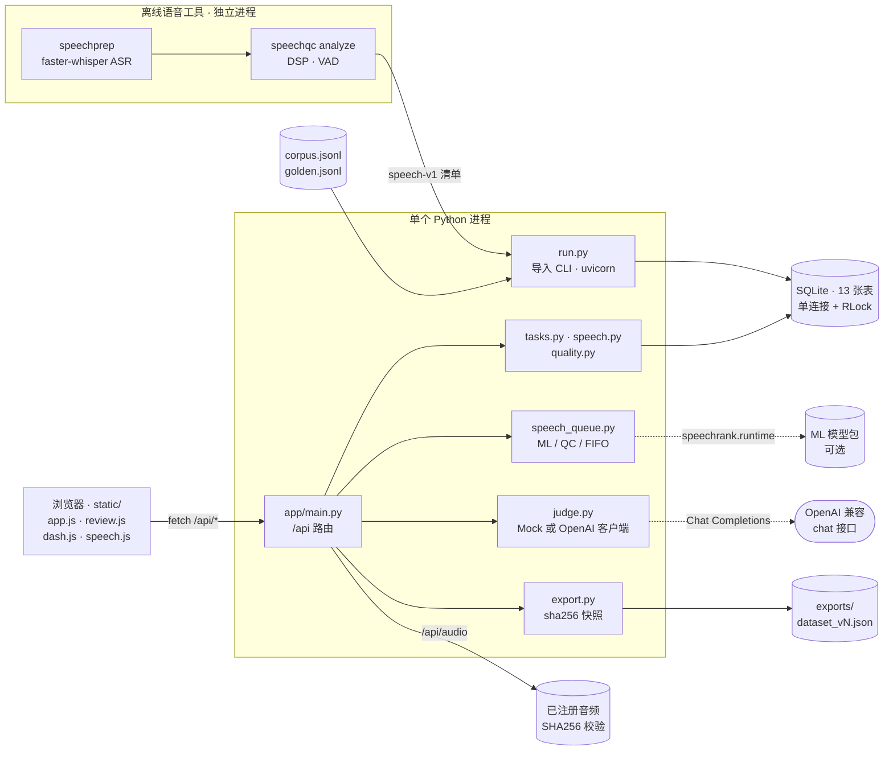
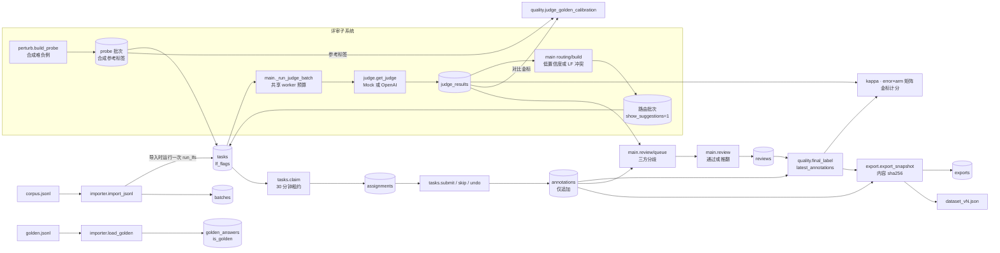
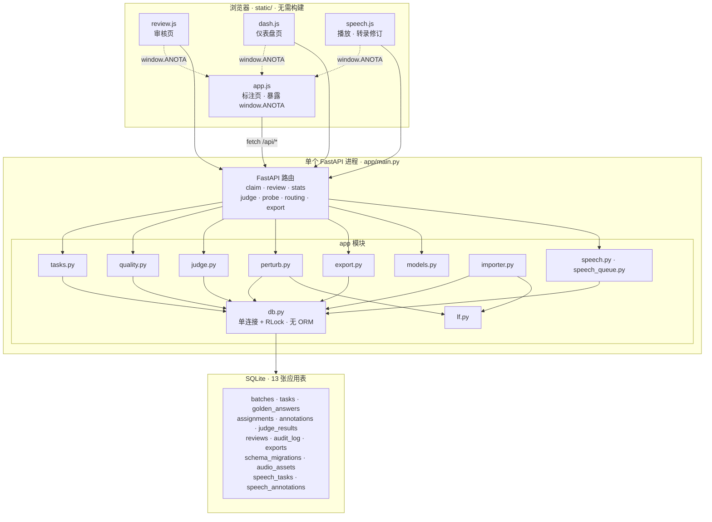
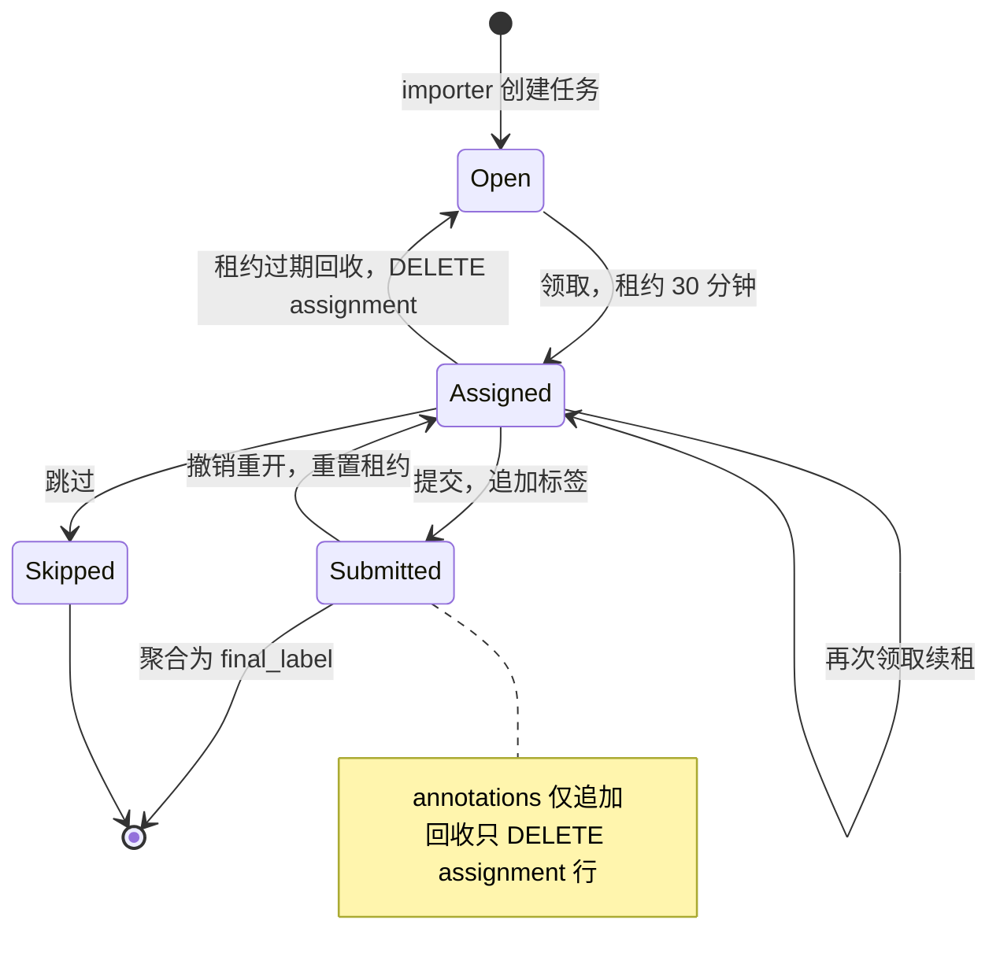

<div align="center">

# Anota&nbsp;Workbench

[English](README.md) · **简体中文**

**标注*界面*容易搭建，可靠的标注*运营*需要系统保障。**

Anota 是一个可自行部署、以键盘操作为先的**翻译质量评估与语音转录审核工作台**。
它把最难的部分直接做进数据模型：盲测金标集、仅追加的审计记录、*先校准才能信任*的 LLM
评审器，以及按内容哈希、可引用的导出。

**一个 Python Web 进程 · 三个核心依赖 · 前端无需构建。**

从下方离线演示开始，或参阅 [Windows 指南](docs/local-windows.md)。
[项目地图](docs/project-map.md) 介绍四个模块、六项冻结研究
以及相关 GitHub 仓库。

<br>


[](https://github.com/HenryVarro666/anota/actions/workflows/tests.yml)


[](https://www.ccao2679.com/projects/#anota)
[](LICENSE)

</div>

<p align="center"></p>


---

<!-- problem-framing:start -->

## 问题与依据

> **在固定的人工审核预算下，经过校准的机器辅助，能否比原始顺序发现更多重要的翻译和转录错误，同时保留盲审与修订可追溯性？**

**为什么值得解决：** 审核时间决定团队能检查多少训练与评测数据。有用的工作台必须帮助审核员发现错误，并输出下游使用者可以追溯的修订。

**核心矛盾：** 提示和排序可以聚焦注意力，但也可能锚定审核员的判断，或掩盖模型支持范围之外的错误。发现更多参考编辑错误，本身并不能证明人工审核更快，也不能证明训练出的模型更好。

[完整问题与验证方案](PROBLEM.zh.md)

<!-- problem-framing:end -->

<a id="quick-start"></a>
## 快速开始

### 启动工作台

**Windows + LM Studio / Ollama：** 请参阅 [Windows 本地指南](docs/local-windows.md)。

建议使用 **Python 3.12**，它是 Windows 上已验证、CI 中配置的版本。
核心标注应用面向 Python ≥3.10；部分语音准备和实验命令使用 `datetime.UTC`（需要 Python ≥3.11）。
完整语音/ML 功能在 Python 3.10 上的兼容性尚未确立。

Windows PowerShell（无需激活虚拟环境）：

```powershell
py -3.12 -m venv .venv
.\.venv\Scripts\python.exe -m pip install -r requirements.txt -c constraints-runtime.txt
.\.venv\Scripts\python.exe run.py --demo
```

Linux / macOS：

```bash
python3.12 -m venv .venv
.venv/bin/python -m pip install -r requirements.txt -c constraints-runtime.txt
.venv/bin/python run.py --demo
```

打开 <http://localhost:8420>。

`--demo` 会启动一个临时数据库，预装 **30 条合成 EN→ES 任务**（12 处预设错误分布在三个延迟实验组中）、
**6 条金标**、第二位标注员的种子标签，以及预先生成的 mock 评审结果，
因此每个页面第一次打开就有数据。

需要持久化数据库时，用同一个 Python 可执行文件，把 `--demo` 替换为 `--db anota.db`。

> 随附演示数据全部为合成数据（为本项目编写的 EN→ES 用药说明）。
> 随附数据**不含真实患者记录**；规模限制另有说明
> （[§限制](#limitations)）。

如需使用独立的本地评审服务，运行下面任一命令：

```powershell
# Windows PowerShell
.\.venv\Scripts\python.exe scripts/run_local.py --judge-profile evals/profiles/local-lmstudio.json
```

```bash
# Linux / macOS
.venv/bin/python scripts/run_local.py --judge-profile evals/profiles/local-lmstudio.json
```

在真实评审运行替换最新结果视图之前，演示结果会一直标记为 mock。
模型发现配置见 [Windows 指南](docs/local-windows.md)，数据集和 ASR 基准见
[项目地图](docs/project-map.md)。

RTX 5080 部署记录：[环境预检与可移植性](docs/5080-environment-and-portability-2026-10-18.md)
和 [CPU/CUDA 真实音频验收](docs/5080-deployment-2026-10-18.md)。
记录对应 2026-10-18 的源码快照和 20 条 FLEURS 冒烟检查；
集群部署、生产容量和 GPU 加速效果均未确立。

<a id="docker"></a>
### Docker

```bash
docker build -t anota .
docker run -p 8420:8420 -v anota-data:/data anota     # 持久数据库存入命名卷
docker run -p 8420:8420 anota --demo                  # 临时演示实例
```

默认镜像运行 CPU Web 应用，只安装三个核心依赖。
它不安装 ASR/VAD/ML 推理依赖，也不包含本地音频、
`runtime/` 数据、研究证据或 SpeechRank 模型包。导入后的语音
审核使用已注册的音频；缺少可选 ML 依赖或模型包时，ML 排序回退至 QC。独立推理镜像和外部模型包见[可移植模型部署](docs/audio-ml-review-queue.md#portable-deployment)。

镜像名之后的参数会传给 `run.py`。本 PR 的
[GitHub Actions 检查](https://github.com/HenryVarro666/anota/pull/1/checks)
已实际通过 CPU 镜像构建、语音审核完整流程，以及缺少模型包
和缺少 ML 依赖两种 QC 回退路径。镜像在 CI 中测试过；
本地 Windows 机器没有执行 Docker。这些检查不能证明
真实 ASR 推理、含 ML 的推理镜像或 AWS 部署已经验证。

---

## 亮点

- **🎧 真实的语音审核。** [20 段中英语音流程](docs/speech-smoke.md)
  把可恢复的离线 CPU ASR 与听音、转录修订和可追溯导出串联起来。
  语音依赖是可选的，Web 进程不加载 ASR 模型。
  在 **Review → Speech review** 选择 ML/QC/原始顺序，然后领取一段音频
  收听并修订。[ML 队列指南](docs/audio-ml-review-queue.md) 介绍
  置信度路由、QC 回退、盲审顺序和可移植的模型部署。

- **🔎 音频 QC 与定点回放。** 独立的 `speechqc` 分析结合 DSP、
  Silero VAD 和转录时间覆盖。Anota 在此之上提供可定位的波形、
  区间/循环选段播放和可点击的审核提示。盲审批次只拿到
  中性波形，机器提示由服务端移除。参阅
  [设计、使用与人工研究计划](docs/audio-qc-v1.md)、
  [66 例冻结工程实验](evals/runs/2026-10-17-audio-qc-v1/RESULTS.md)
  和[集成验证](evals/reviews/audio-qc-v1-integration.md)。

- **🕵️ 天生盲审。** 对采集金标的批次，judge/lint 提示*在返回的 JSON 中就被移除*，
  而不是用 CSS 隐藏。只要盲审领取响应泄漏任何提示字段，测试就会失败。
  锚定偏差无法借 DevTools 溜进来。
- **⚖️ 先校准，再信任评审器。** 带指定参考标签的合成扰动，
  为各错误类别的召回和误报提供可复现的试验。在 Radeon 890M 上真实运行的
  Qwen3-14B 提供了**原始响应、耗时、参考标签分歧
  和模型哈希**。合成参考标签仍需专家复核。
- **🔌 评审服务可替换。** GPT、Gemini 或自托管的 vLLM/Ollama 均可：评审器使用
  OpenAI Chat Completions 协议，换模型只需改**两个环境变量**；自托管时
  内容不会离开你的边界。
- **🧾 仅追加，全程审计。** 修订和撤销都会创建*新*行（以最新行为准）；
  每次领取 / 提交 / 撤销 / 租约回收 / 审核都留下审计记录。标注
  与审计历史完整保留。
- **📐 从零实现的一致性统计。** 手写 Cohen's κ（普通版与线性加权版），用教科书数值
  在测试中固定（2×2 表上为 0.4，相邻类别互换为 −1.0）。不依赖 sklearn。
- **📊 错误类型 × 延迟组分析。** 用一个矩阵研究
  同声传译真正关心的问题：*低延迟要以漏掉多少否定
  和数字为代价？*
- **⚡ 轻量 CPU 应用。** 直接通过 Python 启动，端口 8420，应用运行在
  本地开发环境中。回归测试覆盖标注及评审失败场景。

<div align="center">

### 仪表盘：质量运营一览


</div>

<details>
<summary><b>目录</b></summary>

本地证据：[实验 03](#experiment-03-one-severity-rule-a-new-test-set) · [实验 02](#experiment-02-frozen-holdout-comparison) · [原始试验](#measured-on-a-radeon-890m)

1. [快速开始](#quick-start) · [Docker](#docker)
2. [架构一览](#architecture-at-a-glance)
3. [核心原则](#core-ideas)
4. [完整标注流程](#the-annotation-loop-end-to-end)
5. [键盘快捷键](#keyboard-reference)
6. [概念与数据模型](#concepts--data-model)
7. [标注格式与校验](#annotation-schema--validation)
8. [评审器校准](#the-judge-calibrated)
9. [界面](#screens)
10. 参考（已折叠）：[数据导入](#importing-your-own-data) · [配置](#configuration) · [HTTP API](#http-api) · [导出](#exports) · [目录结构](#project-layout) · [开发](#development)
11. [研究证据](#research-evidence) · [项目地图](docs/project-map.md)
12. [限制](#limitations) · [路线图](#roadmap)

</details>

---

<a id="architecture-at-a-glance"></a>
## 架构一览

可编辑的 [SVG](docs/figures/local-architecture.svg)；可用
`python scripts/render_readme_figure.py` 重新生成（PNG 渲染需要可选依赖 `resvg-py`）。

一个 FastAPI 进程，使用标准库 `sqlite3`（一个连接、一把锁、不用 ORM，这是[有意为之](docs/DESIGN.md)）。
lint 在导入时运行一次；评审子系统为路由和校准提供输入，
但从不阻塞人工标注。



这张运行时视图与上方海报互为补充：它说明哪些部分运行在哪个进程里，以及哪些调用跨越了进程或网络边界。语音 ASR 和 QC 在离线进程中运行，只以 `speech-v1` 清单的形式经 `run.py` 导入应用；虚线是可选路径：只有设置 `ANOTA_JUDGE=openai` 时评审器才会调用 OpenAI 兼容接口（否则由进程内的 `MockJudge` 作答），缺少 `speechrank` 模型包或其依赖时，ML 排序回退至 QC。

进程内部按函数展开的数据流：



<details>
<summary>模块与数据表地图（一个进程、13 张应用表、4 个无需构建的 JS 文件）</summary>



</details>

---

<a id="core-ideas"></a>
## 核心原则

Anota 的主张：*标注界面容易搭建，标注**运营**却不是。*
五项纪律以**系统行为**而非团队约定的方式强制执行：

| # | 纪律 | 系统如何保障 |
|---|---|---|
| 1 | **提示策略由服务端执行** | `show_suggestions` 是 `batches` 表的一列；盲审批次的领取响应*完全不包含* judge/lint 字段：在返回数据中就被移除，而不是用 CSS 隐藏。 |
| 2 | **金标在数据结构上就是盲的** | 蜜罐答案存放在仅服务端可见的表中；任何面向标注员的响应都不包含 `is_golden` 或答案。 |
| 3 | **标签仅追加** | 修订和撤销都创建新行（以最新行为准）；审核员的覆盖叠加在上层；每次状态转换都有审计。 |
| 4 | **评审器只是初筛工具** | 评审结果用于分配任务和排序审核队列，由人做最终裁决。评审器不可用时，标注不受影响。确定性的 `MockJudge` 让演示和 CI 可以离线复现。 |
| 5 | **导出可引用** | 快照使用规范 JSON、按内容哈希（sha256）、带版本号（`dataset@vN`）：相同数据总是得到相同哈希。 |

每项决策的完整理由见 **[docs/DESIGN.md](docs/DESIGN.md)**（还讨论了 Anota
与 Label Studio / Argilla / Prodigy / Scale 的比较、部署成本和路线图）。

---

<a id="the-annotation-loop-end-to-end"></a>
## 完整标注流程

用 5 分钟走完整个闭环：

| # | 步骤 | 发生什么 |
|---|---|---|
| 1 | **Annotate** | 输入标注员 ID，点击 **Start**。一条无错记录只需两次按键（`0` 然后 `Space`）。该批次**不显示机器提示**，用于采集金标（原则 1）。 |
| 2 | **Dashboard** | 错误类型 × 延迟组矩阵显示低延迟组的代价；标注员表格跟踪金标准确率与速度；κ 面板跟踪标注员之间以及评审器与人工之间的一致性。 |
| 3 | **Probe & calibrate** | *Build judge probe* 生成带暂定参考标签的合成错误；*run judge*（共享并发池，实时进度）；校准卡随即填入各类别召回率和误报率。 |
| 4 | **Route** | 按最低评审置信度 *Build routing batch*，然后**标注**该批次：此时领取的任务带有 judge 和 lint 提示（由 mock 评审器生成的标记为 `MOCK`）。 |
| 5 | **Review** | 队列优先列出人工 / 评审器 / lint 有分歧的条目。打开条目查看三方对比；**Approve** 或 **Overturn** 并写下案例说明，作为下一版指南的素材。 |
| 6 | **Export** | 带内容哈希、版本号的快照写入 `exports/`。 |

---

<a id="keyboard-reference"></a>
## 键盘快捷键

在 Annotate 页生效（输入框中除外；按 `Esc` 离开输入框）。

| 按键 | 操作 | 按键 | 操作 |
|---|---|---|---|
| `1–5` | adequacy 评分 | `Space` | 保存并领取下一条 |
| `⇧1–5` | fluency 评分 | `u` | 撤销上次提交（保留原有行，仅追加） |
| `v` | 轮换严重度（neutral → minor → major → critical） | `s` | 跳过 |
| `0` | no_error（独占；设为 neutral，两项评分为 5） | `c` / `x` | 定位修订 / 备注输入框 |
| `m o a t n g r p` | 切换错误类型 | `?` / `Esc` | 指南弹窗 / 离开输入框 |

`m o a t n g r p` 分别对应 mistranslation、omission、addition、terminology、number_unit、
negation_polarity、grammar、punctuation。

---

<a id="concepts--data-model"></a>
## 概念与数据模型

共 13 张应用表：九张翻译/核心表、一张迁移登记表
和三张语音表（不计 SQLite 内部表）。

| 表 | 作用 | 设计说明 |
|---|---|---|
| `batches` | 策略单元 | `show_suggestions`（提示策略）、`overlap`（每个任务的标注人数）、`guideline_version`、`lang_profile` |
| `tasks` | 原文 / 译文 / 参考译文 + 元数据 | lint 结果以 `lf_flags` 内嵌；`metadata.arm` 驱动延迟组矩阵 |
| `golden_answers` | 蜜罐真值 | **仅服务端可见**；从不序列化到标注员路径 |
| `assignments` | 可变的状态机 | 领取 → 30 分钟租约 → 已提交/已跳过；过期租约被回收（有审计），任务回到任务池 |
| `annotations` | 标签 | **仅追加**；每个（任务，标注员）组合以最新行为准 |
| `reviews` | 裁决 | 通过 / 推翻（替代标签行由 `reviewer:<id>` 写入） |
| `judge_results` | LLM 评审结果 | 评审 JSON + 置信度 + `is_mock` 标记 |
| `audit_log` | 全部操作 | 领取/提交/跳过/撤销/回收/审核/导入/导出的仅追加记录 |
| `exports` | 快照登记 | 版本、过滤条件、sha256、路径 |
| `schema_migrations` | 增量迁移登记 | 既有翻译数据库原地获得语音支持 |
| `audio_assets` | 已注册音频 | 路径仅服务端可见；字节按 SHA256 核验 |
| `speech_tasks` | 语音来源追溯 | 把任务与音频及持久化的 ASR/QC 证据关联起来 |
| `speech_annotations` | 转录修订 | 仅追加的修订及审核/播放上下文 |

任务生命周期是后端对正确性最关键的部分，全部在同一把锁下完成：



**分配语义：**标注员提交或跳过某个任务后，不会再次收到它；
只要持有或已提交该任务的其他标注员少于 `overlap` 人，任务就仍可被领取。**最终标签的确定**（供导出、矩阵和一致性统计使用）：
审核员推翻结果优先；否则取单个标注员的最新行；否则取严格多数聚合。
没有多数的聚合结果标记为 `unresolved`，并从 κ 与矩阵统计中**隔离**，
而不是被悄悄强制归类。

---

<a id="annotation-schema--validation"></a>
## 标注格式与校验

- **错误类型（9 种）：**`no_error, mistranslation, omission, addition, terminology, number_unit,
  negation_polarity, grammar, punctuation`：基于 MQM 的集合，并把三个医疗关键类别
  （剂量数字、否定、术语）提升为一级标签。
- **严重度：**`neutral / minor / major / critical`（项目权重 0/1/5/25）。
- **评分：**adequacy 与 fluency，1–5。
- **服务端强制执行的规则**（客户端同步镜像，标注员无需与服务器往返
  就能知道规则）：`no_error` 必须独占并强制严重度为 neutral；真实错误的严重度
  不能是 neutral；`critical` 必须填写非空证据备注。
- 指南（`data/guideline.md`）既在 `?` 弹窗中渲染，**也**注入
  评审器的 system prompt：同一套评分标准，人和模型共用唯一的事实来源。

**内置 lint（labeling functions）**：四个确定性检查在导入时按
语言配置（`en-es`、`zh-en`）运行一次，以带证据的标记附加到任务上；对
审核员和路由可见，对盲审批次的标注员隐藏：

| LF | 检查内容 | 说明 |
|---|---|---|
| `lf_negation_drop` | 原文有否定，译文没有对应 | 处理英语缩写（`don't`） |
| `lf_number_mismatch` | 数字丢失或被改动 | 按语言区分的数字词表：中文复合数字 二十→20、es `once`=11、en `twice`=2 |
| `lf_untranslated_fragment` | 原文片段原样复制 / CJK 残留 | |
| `lf_length_ratio` | 截断 / 过度生成 | 按语言设定范围；原文过短时弃权 |

---

<a id="the-judge-calibrated"></a>
## 评审器校准

在被证明可靠之前，评审器一律视为**未校准的测量工具**。*Build judge
probe* 会创建一批**带预期错误标签的合成难负例**：对干净的演示
译文做程序化扰动（注入否定、首个数字 ×10、替换一个领域术语、删去末尾分句），
再加上未修改的对照。因为注入的错误*就是*预期标签，探针条目会
自动进入评审器与金标的校准卡：各错误类别的召回率、干净条目上的误报率，
以及与合成参考之间的 κ。类别和严重度标签仍需专家审核验证。

[本地实测试验](evals/runs/2026-10-17-lmstudio-qwen3-14b-q4km/report.md)
使用 **Qwen3-14B Q4_K_M、LM Studio / Vulkan、关闭推理**，对 20 条独特
合成样例（11 个父模板）重复运行两次，并公开每条原始
响应和分歧。早期的 vLLM 数字与截图使用含重复对照的另一套
协议，只是历史界面示例，不能作为
可比基线。当前结论以已提交的运行产物为依据。

<div align="center">


</div>

这种对比（受 lint 约束的 MockJudge 与语义 LLM 评审器）正是校准卡的意义：
把评审器的置信度用于路由之前，**先校准，再信任**。评审器故障从不会破坏
标注：顶栏状态徽标降级，人照常工作。各次运行共享可配置的
worker 预算（本地 profile 为 1），可在后台运行，并实时显示 `done/total` 进度。

---

<a id="screens"></a>
## 界面

| 标注（浅色） | 审核与裁决（深色） |
|---|---|
|  |  |

以键盘为先的标注页，带有提示策略说明（“本批次采集金标”）；以及
Human · Judge · LF-Lint 三方对比的审核页，优先为审核员列出分歧。
界面跟随系统浅色/深色主题，也可手动切换。

---

<a id="research-evidence"></a>
## 研究证据

以下冻结研究保留各自的原始协议、结果和限制。
它们测量的问题和数据集各不相同，结果不能连成一条趋势线。
[项目地图](docs/project-map.md#six-frozen-studies) 索引了全部六项研究。

<details>
<summary><b>翻译评审器：原始试验与两次评分规则对比</b></summary>

<!-- SEVERITY_V3_START -->
<a id="experiment-03-one-severity-rule-a-new-test-set"></a>
## 实验 03：统一严重度规则与新测试集


**24 条新主测试文本 · 4 条预先声明的争议文本 · 两轮顺序平衡的主测试。**
候选方案用一条有序规则替换 system rubric：改变临床行动或其前提 → critical；其他含义变化 → major；仅形式错误 → minor；正确翻译 → neutral。基线保留原规则，其余请求设置完全相同。

| 指标 | 基线：第 1 · 2 轮 | 候选：第 1 · 2 轮 |
|---|---:|---:|
| 有效输出 | 24/24 · 24/24 | 24/24 · 24/24 |
| critical 召回 | 12/12 · 12/12 | 12/12 · 12/12 |
| 临床条件 critical 召回 | 6/6 · 6/6 | 6/6 · 6/6 |
| 严重度一致 | 19/24 · 19/24 | 22/24 · 23/24 |
| 错误类型集合完全一致 | 15/24 · 15/24 | 13/24 · 11/24 |
| major/minor 错误误判为 critical | 2/8 · 2/8 | 1/8 · 1/8 |
| 干净对照误报 | 0/4 · 0/4 | 0/4 · 0/4 |
| 合并请求 P50 / P95 | 15.74 / 48.90 s | 16.44 / 56.70 s |

**PASS：两轮均通过全部预先声明的试验门槛。** 默认配置保持不变；仍需独立的双语/领域专家审核参考标签。

**类别取舍：** 类型集合完全一致率的均值下降 12.5 个百分点。通过严重度试验门槛并不能证明完整分类体系的质量。

**已知 critical 回归，h19：** 前一候选为 `omission / major` → severity-v3 为 `omission / critical`。这个缺失临床前提的案例参与了规则设计。对它的单次回访属于开发证据，不能算作留出集收益；原 critical 参考未变。

96 次主请求仅代表 24 个合成源文父项。参考标签与评分规则由同一代理在推理前编写。四项争议案例没有单一金标，单独报告，绝不会在看到预测后悄悄删除。之前各轮及其标签保持原样；由于数据集不同，不能直接连成趋势线。

[完整报告与每个低估案例](evals/runs/2026-10-17-severity-v3/report.md) · [原始证据](evals/runs/2026-10-17-severity-v3/attempts.jsonl) · [统一规则](data/guidelines/severity-v3.md) · [争议登记](evals/reviews/disputed-labels-v3.md) · [协议](evals/severity-v3-protocol.md)

<details><summary>有序严重度规则、完整案例图与可编辑图表</summary>


[对比 SVG](evals/runs/2026-10-17-severity-v3/figures/severity-comparison.svg) · [策略 SVG](evals/runs/2026-10-17-severity-v3/figures/severity-policy.svg) · [案例图 SVG](evals/runs/2026-10-17-severity-v3/figures/case-map.svg)

</details>

[验证与范围](evals/runs/2026-10-17-severity-v3/validation.json)。Windows CPU 检查与实际模型请求分开记录。本实验未测量 H100、AWS、Docker 和跨平台 CI。

**耗时背景：** 用户[确认存在并行计算负载](evals/runs/2026-10-17-severity-v3/validation/user-load-context.json)，但未记录负载的持续时间和强度。所有耗时异常值均保留；延迟门槛仅作描述，不能证明隔离条件下的 prompt 或 890M 性能。

[解读、历史回归与遗留的标签问题](evals/runs/2026-10-17-severity-v3/interpretation.md)。

<!-- SEVERITY_V3_END -->

<!-- COMPARISON_V2_START -->
<a id="experiment-02-frozen-holdout-comparison"></a>
## 实验 02：冻结留出集对比


**24 个新 EN→ES 源文父项 · 两轮顺序平衡 · 相同的 Qwen3-14B Q4_K_M 权重。**
候选只改变 prompt suffix：命题检查、最少且具体的标签、按后果确定严重度。
两组看到同一批样例；原始基线证据和标签保持不变。

| 指标 | 基线：第 1 / 2 轮 | 候选：第 1 / 2 轮 |
|---|---:|---:|
| 有效响应 | 24/24 · 24/24 | 24/24 · 24/24 |
| 有错/无错一致 | 24/24 · 24/24 | 24/24 · 24/24 |
| 类型集合完全一致 | 19/24 · 18/24 | 21/24 · 22/24 |
| 严重度一致 | 15/24 · 15/24 | 14/24 · 15/24 |
| critical 召回 | 9/9 · 9/9 | 8/9 · 8/9 |
| 干净对照误报 | 0/4 · 0/4 | 0/4 · 0/4 |
| 合并请求 P50 / P95 | 14.02 / 18.78 s | 18.14 / 26.58 s |

**HOLD：候选未通过全部预先声明的门槛，基线继续作为默认。**

探索性回访识别出了早先漏检的两处问题（缺失的时间段、medication→supplement 替换），但仍将二者判为 minor。在新留出集上，一项临床行动前提缺失在候选的两轮中都由 critical 降为 major。

精确标签的改善可能来自更清楚的标注约定，而非语义检测能力增强。严重度参考仍为暂定。
新文本、参考标签和候选由同一代理在推理前编写；仍需独立的双语裁决。
96 次留出集调用代表 **24 个源文父项**，而不是 96 个独立样本。所有回归和耗时异常值均保留。

[完整报告、成对得失与回归](evals/runs/2026-10-17-paired-rubric-v2/report.md) · [原始请求](evals/runs/2026-10-17-paired-rubric-v2/attempts.jsonl) · [冻结协议](evals/comparison-v2.md) · [标签诊断](evals/reviews/pilot-v1-audit.md) · [解读与下一项实验](evals/reviews/paired-v2-interpretation.md)

可以准备不含暂定金标和模型提示的[双人盲审批次](evals/reviews/blind-review.md)。
这项 prompt 实验没有修改 system rubric 和默认模型 profile；候选需要显式选择。

冻结评测检查点的验证结果：**130 项 Windows 测试通过**。范围和后续检查见[验证记录](evals/runs/2026-10-17-paired-rubric-v2/validation.json)。Linux/ARM64 CI、Docker、H100 和 AWS 在此均未执行。

<details><summary>逐项对比与可编辑图表</summary>


[总览 SVG](evals/runs/2026-10-17-paired-rubric-v2/figures/comparison.svg) · [案例图 SVG](evals/runs/2026-10-17-paired-rubric-v2/figures/case-map.svg)

</details>

<!-- COMPARISON_V2_END -->

<a id="measured-on-a-radeon-890m"></a>
### Radeon 890M 实测


**2026-10-17 · Ryzen AI 9 HX 370 · Qwen3-14B Q4_K_M · LM Studio 0.4.21 / Vulkan。**
一次预热后，对来自 11 个父模板的 20 个独特合成 EN→ES 样例
随机排序运行两轮。每次一个请求，4096 上下文，JSON schema，`/no_think`。
这是带合成参考标签的真实推理试验，不是临床验证。

| 观测指标 | 第 1 轮 | 第 2 轮 |
|---|---:|---:|
| 有效响应 | 20/20 | 20/20 |
| 有错/无错一致 | 18/20 (90%) | 18/20 (90%) |
| 错误类型集合完全一致 | 11/20 (55%) | 12/20 (60%) |
| 严重度一致 | 14/20 (70%) | 14/20 (70%) |
| critical 召回 | 9/12 (75%) | 9/12 (75%) |
| 干净对照误报 | 0/4 | 0/4 |
| 客户端请求 P50 / P95 | 10.03 / 13.80 s | 10.24 / 13.44 s |

40 次计时请求合并后，**P50 为 10.24 s，P95 为 13.80 s**。两轮的标签
在 **19/20** 个样例上类型和严重度一致。计时包含 prefill 与
生成；重复前缀可能受益于服务端缓存。这些重复且相关的
样例不是 40 个独立的质量样本。

有价值的发现在于粗粒度错误检测与细粒度标签之间的差距。
两轮都漏检了某一项中缺失的 “throughout the day”，以及另一项中的
medication→supplement 替换。多出来的 `mistranslation` 标签也
降低了集合完全一致率，多项严重度评分也与
合成参考不符。结果支持**人工审核的提示与分歧
路由**，不能证明可以自动接受模型结论。下一道质量门槛是一个独立、盲法、
经专家审核的留出集。

[完整结果与每处分歧](evals/runs/2026-10-17-lmstudio-qwen3-14b-q4km/report.md)
· [原始请求/响应](evals/runs/2026-10-17-lmstudio-qwen3-14b-q4km/attempts.jsonl)
· [模型/运行时/代码来源追溯](evals/runs/2026-10-17-lmstudio-qwen3-14b-q4km/manifest.json)
· [复现实验](evals/README.md)
· [可编辑 SVG](docs/figures/local-qwen-evaluation.svg)
· [H100 / AWS 实验边界](docs/runtime-matrix.md)

应用本身仍只用 CPU，模型服务独立运行。在这次原始
试验的检查点，**126 项 Windows 回归测试通过**；Linux/ARM64 和 Docker
检查当时已在 CI 中配置，但没有在本地执行。H100 和 AWS profile 仍是
等待真实验证的模板。上面较新的对比实验记录了各自的检查。

</details>

<details>
<summary><b>音频 QC 与 ASR 审核排序研究</b></summary>

[音频 QC 工程实验](evals/runs/2026-10-17-audio-qc-v1/RESULTS.md)
包含 66 个冻结案例。

[LibriSpeech 排序研究](evals/runs/2026-10-17-librispeech-qc-ranking-v1/README.md)
  复用已有 ASR 结果和官方转录，在 10%/20% 音频时长预算下把 QC 与 1,000 个随机
  审核顺序比较。在全部 5,559 条录音上，冻结的 QC 规则捕获了
  10.06%/19.81% 的错误，随机均值为 9.99%/20.00%；未证明有实用的排序收益。
  中期结果、完整结果、配置和原始证据分别保留。
  [v2 学习试验](evals/runs/2026-10-17-librispeech-ml-ranking-v2/README.md)
  加入 ASR/QC 汇总特征和真实解码器置信度。在按说话人隔离的
  480 条留出录音上，10%/20% 时长预算下 legacy 捕获了 14.97%/28.77%，
  confidence 捕获了 28.65%/46.19% 的错误（随机：9.78%/19.76%）。此前
  暴露过的测试集为次要证据；其缺失的置信度没有伪造。
  这些检查用于识别审核候选；人工准确率和节省的时间仍未测量。

</details>

---

## 参考

<a id="importing-your-own-data"></a>

<details>
<summary><b>导入自己的数据</b></summary>

<br>

```bash
.venv/bin/python run.py --import-file corpus.jsonl --profile generic --lang en-es \
  --batch pilot-1 --golden golden.jsonl --overlap 2
```

**Generic profile**：每行一个 JSON 对象：

```json
{"id": "t001", "source": "…", "translation": "…", "reference": "…",
 "metadata": {"arm": "wait3", "al_ms": 1810}}
```

（`translation` 也可以命名为 `hypothesis`；`reference` 和 `metadata` 可选。延迟组矩阵
依赖的正是 `arm` 元数据。）

**金标文件**：仅服务端使用，每行如下：

```json
{"task_id": "t001", "answer": {"error_types": ["no_error"], "worst_severity": "neutral", "adequacy": 5}}
```

**`aqb` profile** 映射 `source_zh` / `hypothesis_en` / `reference_en` 以及顶层的 `arm`/`AL_ms`
字段（如需添加自己的映射，见 `app/importer.py:PROFILES`）。

重复导入是安全的：`id` 已存在的任务会被跳过并计数，不会
重复创建。`--suggestions` 把导入的批次标记为路由批次（提示可见）。

</details>

<a id="configuration"></a>

<details>
<summary><b>配置</b>：CLI 参数与 LLM 评审器</summary>

<br>

**CLI（`run.py`）：**

| 参数 | 默认值 | 含义 |
|---|---|---|
| `--demo` | 关闭 | 新建临时数据库并装入合成数据 |
| `--db PATH` | `anota.db` | SQLite 文件 |
| `--export-dir PATH` | 应用目录下的 `exports/` | 版本化快照的保存目录 |
| `--speech-manifest PATH` | 未设置 | 导入持久化的 `speech-v1` ASR/QC 结果；已注册音频必须可访问 |
| `--port` / `--host` | `8420` / `127.0.0.1` | 监听地址（容器中为 `0.0.0.0`） |
| `--import-file / --profile / --lang / --batch / --golden / --suggestions / --overlap` | — | 见“导入自己的数据” |

**环境变量（LLM 评审器）：**

| 变量 | 默认值 | 含义 |
|---|---|---|
| `ANOTA_JUDGE` | `mock` | `mock`（确定性，离线）或 `openai` |
| `ANOTA_JUDGE_BASE_URL` | `http://localhost:8000/v1` | 任意 OpenAI 兼容端点：自托管 vLLM / llama.cpp / Ollama、OpenAI、Gemini（兼容接口） |
| `ANOTA_JUDGE_MODEL` | 仅在恰有一个模型时自动发现 | 显式设置准确的 chat 模型 ID；零个或多个模型时发现会失败 |
| `ANOTA_JUDGE_API_KEY` | `EMPTY` | 端点需要认证时使用的 bearer token |
| `ANOTA_JUDGE_SAMPLES` | `1` | 自一致性：以 temperature 0.7 采样 k 次并多数聚合；置信度为各样本间严重度一致的比例 |
| `ANOTA_JUDGE_WORKERS` | `8` | 单个应用进程共享的并发请求预算，1–64；本地启动器使用 1 |
| `ANOTA_JUDGE_TIMEOUT` | `30` | 正且有限的 HTTP I/O 超时秒数；本地启动器使用 120 |
| `ANOTA_JUDGE_MAX_TOKENS` | `512` | 输出预算，32–8192；实测 profile 使用 256 |
| `ANOTA_JUDGE_JSON_SCHEMA` | `0` | `1` 向兼容服务请求严格 JSON schema；本地校验始终执行 |
| `ANOTA_JUDGE_PROMPT_SUFFIX` | 空 | 模型专用的 user prompt 后缀；实测 Qwen profile 使用简短理由和 `/no_think` |

**评审端点契约。** 设置端点、准确的模型 ID 以及所需
凭证。端点/模型必须接受带
`temperature`、`max_tokens` 的 Chat Completions 请求，并在启用时接受所配置的 JSON schema。
协议兼容并不代表与每个服务商/模型都兼容；
请用所选端点实际测试模型发现和生成。

| 服务 | `ANOTA_JUDGE_BASE_URL` | `ANOTA_JUDGE_MODEL`（示例） |
|---|---|---|
| 自托管的兼容服务 | `http://localhost:8000/v1`（取决于服务） | 自动发现（单模型），或服务端的准确 ID |
| **OpenAI 兼容的 chat 模型** | `https://api.openai.com/v1` | `YOUR_CHAT_MODEL_ID` |
| **Gemini 兼容端点** | `https://generativelanguage.googleapis.com/v1beta/openai` | `YOUR_GEMINI_MODEL_ID` |

```bash
# 自托管（默认）：内容不会离开你的机器
ANOTA_JUDGE=openai ANOTA_JUDGE_BASE_URL=http://localhost:8000/v1 .venv/bin/python run.py --demo

# OpenAI GPT
ANOTA_JUDGE=openai ANOTA_JUDGE_BASE_URL=https://api.openai.com/v1 \
  ANOTA_JUDGE_API_KEY="$OPENAI_API_KEY" ANOTA_JUDGE_MODEL=YOUR_CHAT_MODEL_ID .venv/bin/python run.py --demo

# Google Gemini（通过其 OpenAI 兼容端点）
ANOTA_JUDGE=openai ANOTA_JUDGE_BASE_URL=https://generativelanguage.googleapis.com/v1beta/openai \
  ANOTA_JUDGE_API_KEY="$GEMINI_API_KEY" ANOTA_JUDGE_MODEL=YOUR_GEMINI_MODEL_ID .venv/bin/python run.py --demo
```

其他服务商需要实现同一请求契约的网关，并各自
验证。内置评审器不会自动转换服务商专属参数。以上示例使用 POSIX shell 语法；PowerShell 写法和本地服务 profile 见
[Windows 指南](docs/local-windows.md)。

</details>

<a id="http-api"></a>

<details>
<summary><b>HTTP API</b>：全部 JSON 接口位于 <code>/api</code> 下；前端只是一个客户端</summary>

<br>

| 端点 | 方法 | 用途 |
|---|---|---|
| `/claim` | POST | `{annotator, batch_id?}` → 下一任务及进度；**仅**路由批次包含提示字段 |
| `/submit` | POST | 提交标签；`422` 校验失败、`404` 不属于该标注员的分配、`409` 分配未开放 |
| `/speech/review/queue` | GET | 查询参数 `{annotator, batch_id?, sort?, limit?}`；按 ML/QC/FIFO 排列的语音队列，遵守批次策略 |
| `/speech/submit` | POST | 追加一条转录修订，可带不确定片段和审核上下文 |
| `/audio/{audio_id}` | GET | 已注册、经哈希核验的音频；支持 byte-range 播放 |
| `/skip`, `/undo` | POST | 带理由跳过；重新打开上次提交 |
| `/batches` | GET | 批次列表，含 `n_tasks`、提示策略、重叠人数 |
| `/review/queue` | GET | 尚未审核的最新标签，按分歧排序，附带 judge 与 lint 上下文 |
| `/review/{annotation_id}` | POST | `{verdict: approved\|overturned, case_note, replacement?}` |
| `/stats/overview` · `/stats/matrix` · `/stats/annotators` · `/stats/agreement` | GET | 仪表盘聚合（成对 κ、judge×human κ、judge-vs-golden 校准、金标准确率、附 `sources` 说明的 error×arm 矩阵） |
| `/judge/run` | POST | `{batch_id, background?}` → 在共享 worker 预算下评审翻译任务；同步模式返回 `{n}`，后台模式立即返回（`503` 失败，`409` 已在运行或没有翻译任务） |
| `/judge/status` | GET | 各批次评审进度 `{done, total, running, error}` |
| `/probe/build` | POST | `{source_batch_id?, per_type?}` → 自动登记金标真值的合成难负例批次 |
| `/routing/build` | POST | `{top_n, signal: judge_confidence\|lf_conflict}` → 新的路由批次 |
| `/export` | POST | `{batch_id?, include_golden?}` → 版本化快照 |
| `/guideline`, `/health` | GET | 指南文本；服务与评审器状态 |

</details>

<a id="exports"></a>

<details>
<summary><b>导出</b>：按内容哈希、带版本号、可引用</summary>

<br>

`POST /api/export` 写出 `exports/dataset_vN.json`：

- **内容：**任务（source/hypothesis/reference/metadata）、解析后的最终标签（含
  `unresolved` 标记）、每一条原始标签行（包括仅追加的历史）、标注员列表、
  指南版本和过滤条件；
- **完整性：**对内容的规范 JSON 计算 `sha256`：相同数据导出两次，
  哈希完全一致，因此下游工作可以用 `dataset@vN` + 哈希引用；
- 只有显式请求 `include_golden: true` 时才包含金标答案。

`app/export.py` 还提供 `export_golden_jsonl()`，用于金标集的往返导入导出。

</details>

<a id="project-layout"></a>

<details>
<summary><b>目录结构</b></summary>

<br>

```text
run.py               服务、合成演示与翻译/语音导入 CLI
app/                 Anota API、SQLite 迁移、租约、策略、审计和导出
  db.py              13 张应用表；一个连接 + RLock，无 ORM
  speech.py          音频注册、语音导入及不可变的转录修订
  speech_queue.py    ML/QC/原始审核顺序及整队安全回退
  judge.py           确定性 mock 与 OpenAI 兼容翻译评审器
  evaluation.py      评审实验报告与来源追溯
  comparison.py      成对规则实验支持
  severity_study.py  统一严重度实验支持
speechprep/          可选离线 ASR、清单、状态与可恢复缓存
speechqc/            独立音频分析、报告格式与 QC 优先级
speechrank/          冻结的特征/模型与可选的校验后 ML 推理
static/              index.html + app.js + review.js + dash.js + speech.js + style.css
data/                合成演示、金标与版本化指南
scripts/             启动、准备、验证、实验和打包工具
evals/               协议、profile、六项冻结运行及集成复核
tests/               标注、评审、语音/QC/ML 与发布回归检查
docs/                设计、Windows/运行环境指南、项目地图和截图
requirements*.txt    核心依赖与分离的可选依赖环境
```

</details>

<a id="development"></a>

<details>
<summary><b>开发</b></summary>

<br>

```bash
.venv/bin/python -m pytest -q        # 离线运行；无需模型或 GPU
# node --check 每次只检查一个入口；对每个前端文件各运行一次
node --check static/app.js
node --check static/review.js
node --check static/dash.js
node --check static/speech.js
```

PowerShell 中使用 `./.venv/Scripts/python.exe -m pytest -q`。核心测试离线运行；
可选的 ASR/QC/ML 测试在缺少额外依赖时可能跳过。整套测试
通过本身并不能证明真实模型推理或容器行为。测试范围见
[验证命令](docs/local-windows.md#verification)和
[运行环境矩阵](docs/runtime-matrix.md)。

**添加错误类型**：在 `app/models.py` 中扩展 `ERROR_TYPES`，在
`static/app.js`（`ERRORS`）中添加快捷键字母，并在 `data/guideline.md` 中说明。规则会自动生效。

**添加 labeling function**：在 `app/lf.py` 中编写，返回 `(ERROR|OK|ABSTAIN, evidence)`，
注册到 `run_lfs`，在 `LF_TO_ERROR` 中建立映射，并在 `tests/test_lf.py` 中补充测试数据。不确定时
优先 ABSTAIN，不要猜。

**添加导入 profile**：在 `app/importer.py:PROFILES` 中添加一个字典。

**替换评审器**：实现 `.evaluate(task, lf_results) -> dict`，返回的评审键见
`app/judge.py`；规则引擎到托管模型都可以。

**添加扰动**：在 `app/perturb.py` 中添加一个函数（`hyp -> perturbed | None`），连同真值标签
注册到 `PERTURBATIONS`，探针批次会自动使用它。

**重新生成截图**（需要 Chrome 和正在运行的 `--demo` 服务）：

```bash
npm i puppeteer-core && node docs/make_screenshots.js
```

截图脚本默认使用 macOS 上的 Chrome 路径。在 Windows 或 Linux 上，
运行前先把 `CHROME_BIN` 设为浏览器可执行文件路径。例如：

```powershell
$env:CHROME_BIN = 'C:\Program Files\Google\Chrome\Application\chrome.exe'
npm install puppeteer-core
node docs/make_screenshots.js
```

约定：服务端校验是最终依据（客户端仅为操作体验做镜像）；
标签与审计记录从不 UPDATE；任何面向标注员的内容都必须遵守批次策略：
只要盲审批次的领取响应中出现提示字段，测试就会失败。

</details>

---

<a id="limitations"></a>
## 限制

坦白列出，不加隐藏：

- **SQLite + 单进程锁：**只有一个应用进程；生产并发
  和数据集容量尚未确立。部分仪表盘查询存在 N+1。
- **身份由用户自行填写**（`annotator id` 输入框）；真实使用时请通过反向
  代理在前面接入 SSO。审核员身份固定为 `lead`，有待 RBAC。
- **音频 QC 仅供参考：**信号阈值以及 VAD/ASR 时间差异需要
  人工判断。语义转录错误检测和审核省时收益尚未验证。
- 仪表盘每 5 秒轮询，尚未使用 SSE。
- `⇧1–5` 流畅度快捷键假设 US-QWERTY 键盘布局。
- README 文档提供英文和简体中文版本；应用界面文字目前为英语。

<a id="roadmap"></a>
## 路线图

**近期**：反向代理 SSO 身份 · `pipx` 打包 · HF `datasets` 导出 ·
ESA 式片段标注 · 根据案例说明起草新版指南。

**中期**：音频 QC 校准与多 ASR 分歧审核 · 蜜罐轮换与校准批次 · IAA
下钻 · 持续不确定性路由 · 以 xCOMET 作为第二个自动信号。

**长期**：Postgres + SSE · 多项目工作区 · LF 插件注册表。

各项背后的完整理由见 [docs/DESIGN.md §6](docs/DESIGN.md)。

## 许可与复用来源

Anota 项目采用 [MIT](LICENSE) 许可。部分语音工具复用自
用户提供的源码；[来源记录](speechprep/vendor/SOURCES.json)
保存了原始路径、哈希与适配信息。该来源未找到原始许可文件，
来源记录也不主张其具有某个第三方许可。
数据集和模型条款独立于项目许可；再分发前请查阅相应的数据卡
和模型来源。
