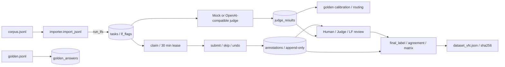

<div align="center">

# Anota Workbench

[English](README.md) | **简体中文**

**标注界面容易搭建，可靠的标注流程需要系统保障。**

Anota 是可自行部署、优先使用键盘操作的**翻译质量评估与语音转录审核工作台**。
盲金标集、仅追加的审计记录、使用前必须校准的 LLM 评审器，以及可通过内容哈希引用的导出，均由数据模型和服务端规则保障。

**一个 Python Web 进程 · 三个核心直接依赖 · 前端无需构建。**

从下方离线演示开始；Windows 用户也可直接阅读 [Windows 本地运行指南](docs/local-windows.md)。
[项目地图](docs/project-map.md) 介绍四个模块、六项冻结研究，以及相关 GitHub 仓库的职责。


[](https://github.com/HenryVarro666/anota/actions/workflows/tests.yml)

[](LICENSE)

</div>

---

<a id="quick-start"></a>
## 快速开始

### 启动工作台

**Windows + LM Studio / Ollama：**请参阅 [Windows 本地指南](docs/local-windows.md)。

建议使用 **Python 3.12**，它是 Windows 已验证和 CI 配置使用的版本。
核心标注应用面向 Python ≥3.10；部分语音准备和实验命令使用 `datetime.UTC`，需要 Python ≥3.11。
完整语音/ML 功能在 Python 3.10 上的兼容性尚未确立。

Windows PowerShell，无需激活虚拟环境：

```powershell
py -3.12 -m venv .venv
.\.venv\Scripts\python.exe -m pip install -r requirements.txt -c constraints-runtime.txt
.\.venv\Scripts\python.exe run.py --demo
```

Linux / macOS：

```bash
python3.12 -m venv .venv
.venv/bin/python -m pip install -r requirements.txt -c constraints-runtime.txt
.venv/bin/python run.py --demo
```

打开 <http://localhost:8420>。

`--demo` 使用临时数据库，预装 **30 条合成 EN→ES 任务**，包含分布在三个延迟实验组中的 12 处预设错误、
**6 条金标**、第二名标注员的种子标签，以及预先生成的 mock 评审结果。首次打开各页面即可看到数据。

需要持久化数据库时，用相同的 Python 可执行文件，把 `--demo` 替换为 `--db anota.db`。

> 随附演示数据均为本项目编写的合成 EN→ES 用药说明，**不含真实患者记录**。
> 部署规模等边界见[限制](#limitations)。

使用独立的本地模型评审服务时，可运行：

```powershell
.\.venv\Scripts\python.exe scripts/run_local.py --judge-profile evals/profiles/local-lmstudio.json
```

Linux / macOS：

```bash
.venv/bin/python scripts/run_local.py --judge-profile evals/profiles/local-lmstudio.json
```

真实评审运行替换最新结果视图之前，演示结果会持续标记为 mock。
模型发现配置见 [Windows 指南](docs/local-windows.md)；数据集和 ASR 基准见[项目地图](docs/project-map.md)。

RTX 5080 部署记录：[环境检查与可移植性约束](docs/5080-environment-and-portability-2026-10-18.md)
和 [CPU/CUDA 真实音频验收](docs/5080-deployment-2026-10-18.md)。
记录对应 2026-10-18 的源代码快照和 20 条 FLEURS 工程冒烟检查，
未证明集群部署、生产容量或 GPU 加速效果。

<a id="docker"></a>
### Docker

```bash
docker build -t anota .
docker run -p 8420:8420 -v anota-data:/data anota
docker run -p 8420:8420 anota --demo
```

第一条运行命令把持久数据库存入命名卷 `anota-data`；第二条启动临时演示实例。
镜像名后的参数会传给 `run.py`。

默认镜像运行 CPU Web 应用，仅安装三个核心依赖；不安装 ASR/VAD/ML 推理依赖，
也不包含本地音频、`runtime/` 数据、研究证据或 SpeechRank 模型包。
语音审核需要已注册的音频；缺少可选 ML 依赖或模型包时，排序回退至 QC。
独立推理镜像和外部模型包配置见[可移植部署](docs/audio-ml-review-queue.md#portable-deployment)。

本 PR 的 [GitHub Actions 检查](https://github.com/HenryVarro666/anota/pull/1/checks) 已实际验证 CPU 镜像构建、
语音审核完整流程，以及缺模型包/缺 ML 依赖时的 QC 回退。后续发布仍应检查对应提交的实际 CI 结果。
本地 Windows 机器没有执行 Docker。这些检查未证明真实 ASR 推理、含 ML 的推理镜像或 AWS 部署已验证。

---

<a id="highlights"></a>
## 主要功能

- **真实语音审核流程。** [20 段中英语音示例](docs/speech-smoke.md) 将可恢复的离线 CPU ASR，连接到听音、转录修订与可追溯导出。语音依赖可选，Web 进程不加载 ASR 模型。在 **Review → Speech review** 选择 ML/QC/原始顺序，再领取音频进行修订。[ML 队列指南](docs/audio-ml-review-queue.md) 说明置信度路由、QC 回退、盲审顺序及模型包部署。
- **音频 QC 与精确回放。** 独立 `speechqc` 分析结合 DSP、Silero VAD 和转录时间覆盖。界面提供可定位波形、区间/循环播放及可点击的审核提示。盲审批次仅显示中性波形，服务端移除机器提示。参阅[设计与使用](docs/audio-qc-v1.md)、[66 例冻结工程实验](evals/runs/2026-10-17-audio-qc-v1/RESULTS.md)和[集成验证](evals/reviews/audio-qc-v1-integration.md)。
- **由服务端保障盲审。** 收集金标的批次在返回 JSON 时就移除 judge/lint 提示；不只是用 CSS 隐藏。回归测试检查提示字段不会泄漏给盲审标注员。
- **先校准，再使用评审器。** 为合成扰动指定参考标签，用可复现试验测量各错误类别召回率和误报。Radeon 890M 上的 Qwen3-14B 实测提供原始响应、耗时、标签分歧和模型哈希；合成参考标签仍需专家复核。
- **评审服务可替换。** 使用 OpenAI Chat Completions 协议，可连接 GPT、Gemini 或自托管 vLLM/Ollama 等兼容服务。选择服务地址和模型无需修改代码；数据边界取决于所选服务部署位置。
- **仅追加并完整审计。** 修订和撤销重提都创建新行，读取时以最新行为准。领取、提交、撤销、租约回收、审核均留下审计记录。
- **可验证的一致性统计。** 手写 Cohen's κ 与线性加权 κ，使用教科书数值测试固定行为，不依赖 sklearn。
- **错误类型 × 延迟组分析。** 查看低延迟翻译实验组中的否定、数字等错误分布。
- **轻量 CPU 应用。** 直接通过 Python 启动，默认端口 8420，无前端构建过程；回归测试覆盖标注及评审失败路径。


<a id="contents"></a>
## 目录

1. [快速开始](#quick-start) · [Docker](#docker)
2. [架构](#architecture) · [核心原则](#core-ideas)
3. [完整标注流程](#annotation-loop) · [键盘快捷键](#keyboard)
4. [数据模型](#data-model) · [标注格式与校验](#schema)
5. [评审器校准](#judge) · [界面](#screens)
6. [研究证据：六项冻结研究](#research)
7. [数据导入](#importing-your-own-data) · [配置](#configuration) · [HTTP API](#http-api)
8. [导出](#exports) · [目录结构](#project-layout) · [开发](#development)
9. [限制](#limitations) · [路线图](#roadmap) · [许可与复用来源](#license) · [相关项目](#related-projects)

---

<a id="architecture"></a>
## 架构


可编辑的 [SVG](docs/figures/local-architecture.svg) 可通过 `python scripts/render_readme_figure.py` 重新生成；PNG 渲染需要可选依赖 `resvg-py`。

一个 FastAPI 进程使用标准库 `sqlite3`，共享一个数据库连接和一个 `RLock`，不使用 ORM。
[设计说明](docs/DESIGN.md) 解释这一选择。lint 在导入时运行一次；评审子系统用于校准和任务路由，不阻塞人工标注。



仓库包含四个协作模块，目前并非四个独立发行的软件包：

| 模块 | 路径 | 职责与运行边界 |
|---|---|---|
| Anota 工作台 | `app/`、`static/`、`run.py` | 翻译标注、听音修订、审核、审计和导出；CPU Web 进程 |
| SpeechPrep | `speechprep/` | 音频清单、离线 ASR、状态与可恢复缓存；在 Web 进程外执行 |
| SpeechQC | `speechqc/` | 信号/VAD/时间覆盖分析与 QC 优先级；Web 审核可使用无需模型的格式/优先级工具 |
| SpeechRank | `speechrank/` | 固定特征、模型训练工具和可验证推理；推理依赖与模型包可选，Web 进程不训练模型 |

前端为四个无需构建的 JavaScript 入口：`app.js`、`review.js`、`dash.js`、`speech.js`。
`app.js` 暴露 `window.ANOTA` 供其他入口使用。`app/main.py` 提供路由，
`app/db.py` 管理 **13 张应用表**；共享 Web 运行逻辑放在模块中，不依赖研究脚本。

<a id="core-ideas"></a>
## 核心原则

| 原则 | 系统如何保障 |
|---|---|
| 服务端执行提示策略 | `batches.show_suggestions` 决定是否显示提示；盲审领取响应不包含 judge/lint 字段 |
| 金标对标注员不可见 | `golden_answers` 仅供服务端使用；标注员响应不包含 `is_golden` 或答案 |
| 标签仅追加 | 修订、撤销后重提都新增行；审核覆盖在聚合时生效，每次状态转换均有审计 |
| 评审器只是初筛工具 | 结果用于路由和审核排序，人类作最终裁决；评审器不可用时人工流程继续；`MockJudge` 离线且确定性运行 |
| 导出可引用、可核验 | 使用规范 JSON、内容 SHA256 和 `dataset@vN` 版本；相同内容始终得到相同哈希 |

[设计文档](docs/DESIGN.md) 还讨论与 Label Studio、Argilla、Prodigy、Scale 的定位比较，以及部署和演进选择。

<a id="annotation-loop"></a>
## 完整标注流程

| 步骤 | 操作与结果 |
|---|---|
| 1. Annotate | 输入标注员 ID，点击 **Start**。无错误记录按 `0`、`Space` 即可提交。盲审批次不显示机器提示，用于采集独立标签 |
| 2. Dashboard | 查看错误类型 × 延迟组矩阵、标注员金标准确率与速度、标注员间及评审器与人工之间的 κ |
| 3. Probe & calibrate | **Build judge probe** 生成带暂定参考标签的合成错误；**run judge** 运行评审，显示实时进度和分类召回/误报 |
| 4. Route | **Build routing batch** 按低置信度或 LF 冲突选出任务；该批次显示 judge/lint 提示，mock 结果带 `MOCK` 标记 |
| 5. Review | 优先显示人工、评审器与 lint 有分歧的任务；使用 **Approve** 或 **Overturn**，并记录案例说明 |
| 6. Export | 生成带内容哈希、版本号的快照，保存到 `exports/` |

<a id="keyboard"></a>
## 键盘快捷键

在 Annotate 页生效；输入框中暂停快捷键，按 `Esc` 离开输入框。

| 按键 | 操作 | 按键 | 操作 |
|---|---|---|---|
| `1–5` | adequacy 评分 | `Space` | 保存并领取下一条 |
| `⇧1–5` | fluency 评分 | `u` | 撤销上次提交，保留历史行 |
| `v` | 轮换 neutral → minor → major → critical | `s` | 跳过 |
| `0` | 选择独占的 `no_error`，设 neutral、两项评分 5 | `c` / `x` | 定位修订 / 备注输入框 |
| `m o a t n g r p` | 切换错误类型 | `?` / `Esc` | 查看指南 / 离开输入框 |

`m o a t n g r p` 分别对应 `mistranslation`、`omission`、`addition`、`terminology`、
`number_unit`、`negation_polarity`、`grammar`、`punctuation`。

<a id="data-model"></a>
## 数据模型

共 13 张应用表：九张翻译/核心表、一张迁移登记表、三张语音表，不计 SQLite 内部表。

| 表 | 用途与约束 |
|---|---|
| `batches` | 批次策略：`show_suggestions`、`overlap`、`guideline_version`、`lang_profile` |
| `tasks` | 原文、译文、参考译文及元数据；`lf_flags` 保存 lint 结果，`metadata.arm` 驱动延迟组矩阵 |
| `golden_answers` | 服务端金标，不传给标注员 |
| `assignments` | 可变的领取状态机：领取、30 分钟租约、提交/跳过；过期租约回收并审计 |
| `annotations` | 仅追加标签；每个任务与标注员组合读取最新行 |
| `reviews` | 通过或推翻；替代标签由 `reviewer:<id>` 提交 |
| `judge_results` | 评审 JSON、置信度和 `is_mock` 标记 |
| `audit_log` | 领取、提交、跳过、撤销、回收、审核、导入、导出的仅追加记录 |
| `exports` | 快照版本、过滤条件、SHA256 和路径 |
| `schema_migrations` | 增量迁移登记，使既有翻译数据库原地获得语音支持 |
| `audio_assets` | 已注册音频；本地路径仅服务端可见，字节通过 SHA256 核验 |
| `speech_tasks` | 任务与音频、持久化 ASR/QC 证据的关联 |
| `speech_annotations` | 仅追加的转录修订及审核/播放上下文 |

状态转换在同一把锁下完成：`Open → Assigned → Submitted/Skipped`。
再次领取可续租；过期租约仅删除 assignment 并返回任务池；撤销提交会重新打开 assignment 并重设租约。
标签与审计历史不删除。

标注员提交或跳过后，正常分配不会再次收到该任务；其他标注员的已领取/已提交人数少于 `overlap` 时仍可领取。
租约回收后，同一标注员可能再次领取，重提结果覆盖读取视图而不覆盖历史行。

**最终标签顺序：**审核员推翻结果优先；否则取单个标注员的最新标签；多人标注则使用严格多数聚合。
无多数的任务标记为 `unresolved`，从 κ 与矩阵统计中隔离，避免静默强制归类。

<a id="schema"></a>
## 标注格式与校验

- **九种错误类型：**`no_error, mistranslation, omission, addition, terminology, number_unit, negation_polarity, grammar, punctuation`。基于 MQM，并将剂量数字、否定、术语作为独立类别。
- **严重度：**`neutral / minor / major / critical`，本项目配置的权重分别为 0/1/5/25。
- **评分：**adequacy 与 fluency，范围 1–5。
- **服务端规则：**`no_error` 必须独占并强制 neutral；真实错误不能为 neutral；critical 必须填写非空证据备注。客户端同步校验以改善操作体验，服务端为最终依据。
- `data/guideline.md` 同时用于 `?` 弹窗与评审器 system prompt，人工和模型使用同一评分依据。

四种确定性 LF 在导入时按语言配置（`en-es`、`zh-en`）运行一次。带证据的结果用于审核与路由，盲审批次不展示。

| LF | 检查内容 | 边界 |
|---|---|---|
| `lf_negation_drop` | 源文否定在译文中缺失 | 处理 `don't` 等英语缩写 |
| `lf_number_mismatch` | 数字丢失或变化 | 按语言处理数字词：二十→20、es `once`=11、en `twice`=2 |
| `lf_untranslated_fragment` | 原文片段直接复制、CJK 残留 | 提供证据供人工判断 |
| `lf_length_ratio` | 截断或过度生成 | 使用语言范围阈值，短原文弃权 |

<a id="judge"></a>
## 评审器校准

评审器在验证之前视为**未校准测量工具**。**Build judge probe** 对干净演示译文施加程序扰动：
注入否定、首个数字乘 10、替换领域术语、删除末尾分句，并加入未修改对照。
预期错误标签自动用于评审器与金标的校准卡，报告各错误类别召回、干净样本误报和 κ。
这些标签是合成参考，类别与严重度仍需专家验证。

[本地实测](evals/runs/2026-10-17-lmstudio-qwen3-14b-q4km/report.md) 使用 Qwen3-14B Q4_K_M、
LM Studio/Vulkan、关闭推理，对 20 条独特合成样例（11 个父模板）运行两轮，并公开所有原始响应和分歧。
早期 vLLM 数字与截图使用含重复对照的另一协议，仅作为历史界面展示，不可直接作为对比基线。


评审器不可用时，顶栏状态降级，人工标注照常进行。运行共享可配置的并发请求预算；
本地 profile 使用一个 worker，可在后台查看 `done/total` 进度。校准通过之前，不应把置信度直接当作可靠路由依据。

<a id="screens"></a>
## 界面

| 标注（浅色） | 审核与裁决（深色） |
|---|---|
|  |  |

标注页提示当前批次是否收集金标；审核页比较 Human、Judge、LF-Lint，优先展示分歧。
界面文字目前为英语，主题可跟随系统或手动切换；本 README 提供中英文文档入口。

---

<a id="research"></a>
## 研究证据：六项冻结研究

各研究保留原协议、结果和限制。它们测量的问题和数据集不同，**不能拼接为一条提升趋势**。
[项目地图](docs/project-map.md#six-frozen-studies) 提供六项研究索引。历史测试数量描述各自冻结检查点，不代表当前发布检查。

<a id="severity-v3"></a>
### 实验 03：统一严重度规则与新测试集


**24 条新主测试文本、4 条预先声明的争议文本、两轮顺序平衡主测试。**
候选 system rubric 使用一条有序规则：改变临床行动或其前提 → critical；其他含义变化 → major；
仅形式错误 → minor；正确翻译 → neutral。基线保留原规则，其他请求参数相同。

| 指标 | 基线：第 1 · 2 轮 | 候选：第 1 · 2 轮 |
|---|---:|---:|
| 有效输出 | 24/24 · 24/24 | 24/24 · 24/24 |
| critical 召回 | 12/12 · 12/12 | 12/12 · 12/12 |
| 临床条件 critical 召回 | 6/6 · 6/6 | 6/6 · 6/6 |
| 严重度一致 | 19/24 · 19/24 | 22/24 · 23/24 |
| 错误类型集合完全一致 | 15/24 · 15/24 | 13/24 · 11/24 |
| major/minor 误判为 critical | 2/8 · 2/8 | 1/8 · 1/8 |
| 干净对照误报 | 0/4 · 0/4 | 0/4 · 0/4 |
| 合并请求 P50 / P95 | 15.74 / 48.90 s | 16.44 / 56.70 s |

**PASS：两轮均通过预先声明的试验门槛；默认配置保持不变。**仍需独立双语/领域专家审核参考标签。
类型集合完全一致率的两轮均值下降 12.5 个百分点，严重度门槛通过不能证明完整分类体系质量。

已知 critical 回归案例 h19：前一候选给出 `omission / major`，本轮改为 `omission / critical`。
该临床前提缺失案例参与了规则设计，单次回访属于开发证据，不能计入留出集收益；原 critical 参考未变。

96 次主请求仅代表 24 个合成源文父项。参考标签与规则由同一代理在推理前编写。
四项争议案例没有单一金标，单独报告；各轮不同数据不能直接比较趋势。
用户确认存在[并行计算负载](evals/runs/2026-10-17-severity-v3/validation/user-load-context.json)，
但未记录负载持续时间和强度；保留全部耗时异常值，延迟门槛仅作描述，不能证明隔离条件下的 prompt 或 890M 性能。

[完整报告与低估案例](evals/runs/2026-10-17-severity-v3/report.md) · [原始证据](evals/runs/2026-10-17-severity-v3/attempts.jsonl) · [统一规则](data/guidelines/severity-v3.md) · [争议登记](evals/reviews/disputed-labels-v3.md) · [协议](evals/severity-v3-protocol.md) · [验证范围](evals/runs/2026-10-17-severity-v3/validation.json) · [解释与未决问题](evals/runs/2026-10-17-severity-v3/interpretation.md)

该实验分别记录 Windows CPU 检查与实际模型请求，未测量 H100、AWS、Docker 或跨平台 CI。
可编辑图：[对比](evals/runs/2026-10-17-severity-v3/figures/severity-comparison.svg)、[策略](evals/runs/2026-10-17-severity-v3/figures/severity-policy.svg)、[案例图](evals/runs/2026-10-17-severity-v3/figures/case-map.svg)。

<a id="paired-v2"></a>
### 实验 02：冻结留出集对比


**24 个新 EN→ES 源文父项、两轮顺序平衡、相同 Qwen3-14B Q4_K_M 权重。**
候选仅改变 prompt suffix：命题检查、最少且具体的标签、按后果确定严重度。
两组使用同一批样例；原始基线证据和标签保持不变。

| 指标 | 基线：第 1 · 2 轮 | 候选：第 1 · 2 轮 |
|---|---:|---:|
| 有效响应 | 24/24 · 24/24 | 24/24 · 24/24 |
| 有错/无错一致 | 24/24 · 24/24 | 24/24 · 24/24 |
| 类型集合完全一致 | 19/24 · 18/24 | 21/24 · 22/24 |
| 严重度一致 | 15/24 · 15/24 | 14/24 · 15/24 |
| critical 召回 | 9/9 · 9/9 | 8/9 · 8/9 |
| 干净对照误报 | 0/4 · 0/4 | 0/4 · 0/4 |
| 合并请求 P50 / P95 | 14.02 / 18.78 s | 18.14 / 26.58 s |

**HOLD：候选未通过所有预先声明门槛，基线继续作为默认。**
探索性回访识别了早先漏检的时间段缺失和 medication→supplement 替换，但仍将二者判为 minor。
新留出集中，一项临床行动前提缺失在候选两轮中均由 critical 降为 major。

精确标签改善可能来自更清楚的标注约定，而不代表语义检测增强。严重度参考仍为暂定；
新文本、标签和候选由同一代理在推理前编写，需要独立双语裁决。
96 次留出集调用是 **24 个源文父项**，并非 96 个独立样本；回归和耗时异常值全部保留。

[报告、成对得失与回归](evals/runs/2026-10-17-paired-rubric-v2/report.md) · [原始请求](evals/runs/2026-10-17-paired-rubric-v2/attempts.jsonl) · [冻结协议](evals/comparison-v2.md) · [标签诊断](evals/reviews/pilot-v1-audit.md) · [解释](evals/reviews/paired-v2-interpretation.md)

可准备不含暂定金标和模型提示的[双人盲审批次](evals/reviews/blind-review.md)。
该实验未修改 system rubric 或默认模型 profile，候选需显式选择。
冻结检查点为 **130 项 Windows 测试通过**；[验证记录](evals/runs/2026-10-17-paired-rubric-v2/validation.json) 说明范围。
该实验未执行 Linux/ARM64 CI、Docker、H100 或 AWS。
可编辑图：[总览](evals/runs/2026-10-17-paired-rubric-v2/figures/comparison.svg)、[案例图](evals/runs/2026-10-17-paired-rubric-v2/figures/case-map.svg)。

<a id="original-pilot"></a>
### 原始本地试验：Radeon 890M 实测


**2026-10-17 · Ryzen AI 9 HX 370 · Qwen3-14B Q4_K_M · LM Studio 0.4.21 / Vulkan。**
一次预热后，对来自 11 个父模板的 20 个独特合成 EN→ES 样例随机排序运行两轮。
每次一个请求，4096 上下文，JSON schema，`/no_think`。
这是带合成参考的真实推理试验，不是临床验证。

| 指标 | 第 1 轮 | 第 2 轮 |
|---|---:|---:|
| 有效响应 | 20/20 | 20/20 |
| 有错/无错一致 | 18/20（90%） | 18/20（90%） |
| 类型集合完全一致 | 11/20（55%） | 12/20（60%） |
| 严重度一致 | 14/20（70%） | 14/20（70%） |
| critical 召回 | 9/12（75%） | 9/12（75%） |
| 干净对照误报 | 0/4 | 0/4 |
| 客户端请求 P50 / P95 | 10.03 / 13.80 s | 10.24 / 13.44 s |

40 次计时请求合并后 P50 **10.24 s**、P95 **13.80 s**；20 项中有 **19 项**在两轮中的类型和严重度一致。
计时含 prefill 与生成；重复前缀可能受益于服务端缓存。相关且重复的样例不是 40 个独立质量样本。

两轮都漏检了某项 “throughout the day” 缺失和另一项 medication→supplement 替换。
额外的 `mistranslation` 标签降低了集合完全一致率，多项严重度也与合成参考不符。
结果支持**人工审核提示与分歧路由**，不能证明可自动接受模型结论；下一质量门槛是独立、盲法、专家审核的留出集。

[完整结果与分歧](evals/runs/2026-10-17-lmstudio-qwen3-14b-q4km/report.md) · [原始请求/响应](evals/runs/2026-10-17-lmstudio-qwen3-14b-q4km/attempts.jsonl) · [模型/运行时/源码追溯](evals/runs/2026-10-17-lmstudio-qwen3-14b-q4km/manifest.json) · [复现实验](evals/README.md) · [可编辑 SVG](docs/figures/local-qwen-evaluation.svg) · [H100/AWS 边界](docs/runtime-matrix.md)

Web 应用使用 CPU，模型服务独立运行。原始检查点 **126 项 Windows 回归测试通过**；
当时配置了 Linux/ARM64 与 Docker CI，但没有本地执行。H100/AWS profile 仍为待验证模板。

<a id="audio-studies"></a>
### 音频 QC 与 ASR 审核排序研究

| 研究 | 证据与结果 | 结论边界 |
|---|---|---|
| [Audio QC v1](evals/runs/2026-10-17-audio-qc-v1/RESULTS.md) | 66 个冻结工程案例 | 信号检查提供建议；没有验证人工准确率或省时收益 |
| [LibriSpeech QC ranking v1](evals/runs/2026-10-17-librispeech-qc-ranking-v1/README.md) | 复用 ASR 与官方转录，在 10%/20% 音频时长预算下与 1,000 个随机顺序比较；5,559 条录音上 QC 捕获错误比例 10.06%/19.81%，随机均值 9.99%/20.00% | 固定 QC 规则未证明有用排序收益；中期/完整结果、配置和原始证据分别保留 |
| [LibriSpeech ML ranking v2](evals/runs/2026-10-17-librispeech-ml-ranking-v2/README.md) | 增加 ASR/QC 汇总特征及真实解码器置信度；按说话人隔离的 480 条留出录音上，10%/20% 时长预算下 legacy 捕获 14.97%/28.77%，confidence 捕获 28.65%/46.19%，随机为 9.78%/19.76% | 两种方案分别评估；早先暴露过的测试集为次要证据，缺失置信度未伪造。混合方案队列和人工效率未验证 |

SpeechRank 已审核运行域为**英语 LibriSpeech、固定 `Systran/faster-whisper-base` revision 与解码配置**。
中文和其他 ASR 模型回退至 QC；相同来源配置在其他英语语料上的使用仍属探索。
参阅[精确运行域约定](docs/audio-ml-review-queue.md#supported-asr-domain)。
以上排序用于识别审核候选，没有测量人工准确率或节省时间。

---

<a id="importing-your-own-data"></a>
## 数据导入

```bash
.venv/bin/python run.py --import-file corpus.jsonl --profile generic --lang en-es \
  --batch pilot-1 --golden golden.jsonl --overlap 2
```

PowerShell 中使用 `.\.venv\Scripts\python.exe`，并将示例参数写在同一行；反斜杠是 Bash 续行语法。

**generic profile：**每行一个 JSON 对象。

```json
{"id": "t001", "source": "…", "translation": "…", "reference": "…", "metadata": {"arm": "wait3", "al_ms": 1810}}
```

`translation` 可命名为 `hypothesis`；`reference` 和 `metadata` 可选。
`metadata.arm` 用于延迟组矩阵。

**金标文件：**仅服务端使用，每行如下。

```json
{"task_id": "t001", "answer": {"error_types": ["no_error"], "worst_severity": "neutral", "adequacy": 5}}
```

`aqb` profile 映射 `source_zh` / `hypothesis_en` / `reference_en`，以及顶层 `arm` / `AL_ms`；
自定义映射位于 `app/importer.py:PROFILES`。
重复导入会跳过并统计已有 `id`，不创建重复任务。
`--suggestions` 将导入批次设为可见机器提示的路由批次。

<a id="configuration"></a>
## 配置

### CLI：`run.py`

| 参数 | 默认值 | 说明 |
|---|---|---|
| `--demo` | 关闭 | 新建临时数据库并装入合成演示数据 |
| `--db PATH` | `anota.db` | SQLite 文件 |
| `--port` / `--host` | `8420` / `127.0.0.1` | 监听地址，容器使用 `0.0.0.0` |
| `--import-file / --profile / --lang / --batch / --golden / --suggestions / --overlap` | — | 见[数据导入](#importing-your-own-data) |
| `--speech-manifest PATH` | 无 | 导入持久化 `speech-v1` ASR/QC 结果；已注册音频必须可访问 |
| `--export-dir PATH` | 应用目录下的 `exports/` | 导出快照保存目录 |

### LLM 评审环境变量

| 变量 | 默认值 | 说明 |
|---|---|---|
| `ANOTA_JUDGE` | `mock` | `mock` 为离线确定性评审，`openai` 使用兼容端点 |
| `ANOTA_JUDGE_BASE_URL` | `http://localhost:8000/v1` | OpenAI Chat Completions 兼容地址 |
| `ANOTA_JUDGE_MODEL` | 仅在恰有一个模型时自动发现 | 建议显式指定准确的 chat 模型 ID；零个或多个模型会发现失败 |
| `ANOTA_JUDGE_API_KEY` | `EMPTY` | 服务需要认证时使用 bearer token |
| `ANOTA_JUDGE_SAMPLES` | `1` | 以 temperature 0.7 采样 k 次并多数聚合，置信度为样本严重度一致比例 |
| `ANOTA_JUDGE_WORKERS` | `8` | 单个应用进程的共享并发请求预算，1–64；本地启动器使用 1 |
| `ANOTA_JUDGE_TIMEOUT` | `30` | 正且有限的 HTTP I/O 超时秒数；本地启动器使用 120 |
| `ANOTA_JUDGE_MAX_TOKENS` | `512` | 输出预算，32–8192；实测 profile 使用 256 |
| `ANOTA_JUDGE_JSON_SCHEMA` | `0` | `1` 向支持的服务请求严格 JSON schema；本地结果校验始终执行 |
| `ANOTA_JUDGE_PROMPT_SUFFIX` | 空 | 模型专用 user prompt 后缀；实测 Qwen profile 使用简短理由和 `/no_think` |

评审服务按协议兼容；切换地址与模型一般只需设置两个环境变量，认证另行提供。

| 服务 | `ANOTA_JUDGE_BASE_URL` | `ANOTA_JUDGE_MODEL` 示例 |
|---|---|---|
| 自托管 vLLM / llama.cpp / Ollama | `http://localhost:8000/v1` | 单模型时可自动发现 |
| OpenAI GPT | `https://api.openai.com/v1` | `YOUR_CHAT_MODEL_ID` |
| Google Gemini 兼容接口 | `https://generativelanguage.googleapis.com/v1beta/openai` | `YOUR_GEMINI_MODEL_ID` |

模型 ID 需按实际服务选择；没有验证全部提供商或模型。自托管服务的端口和兼容路径以实际配置为准。

PowerShell 示例：

```powershell
$env:ANOTA_JUDGE = "openai"
$env:ANOTA_JUDGE_BASE_URL = "http://localhost:8000/v1"
$env:ANOTA_JUDGE_MODEL = "your-chat-model-id"
.\.venv\Scripts\python.exe run.py --demo
```

Bash 示例：

```bash
ANOTA_JUDGE=openai ANOTA_JUDGE_BASE_URL=http://localhost:8000/v1 .venv/bin/python run.py --demo

ANOTA_JUDGE=openai ANOTA_JUDGE_BASE_URL=https://api.openai.com/v1 \
  ANOTA_JUDGE_API_KEY="$OPENAI_API_KEY" ANOTA_JUDGE_MODEL=YOUR_CHAT_MODEL_ID .venv/bin/python run.py --demo

ANOTA_JUDGE=openai ANOTA_JUDGE_BASE_URL=https://generativelanguage.googleapis.com/v1beta/openai \
  ANOTA_JUDGE_API_KEY="$GEMINI_API_KEY" ANOTA_JUDGE_MODEL=YOUR_GEMINI_MODEL_ID .venv/bin/python run.py --demo
```

其他服务需要实现相同请求契约的兼容网关，并分别验证；内置评审器不会自动转换服务专属参数。
接口及所选模型需要支持本应用使用的 `temperature`、`max_tokens` 和所选的可选 JSON schema 参数。
部分推理模型不接受 `temperature`；代理本身不能保证全部模型兼容。

<a id="http-api"></a>
## HTTP API

全部 JSON 接口位于 `/api` 下，前端只是 API 客户端。下表省略 `/api` 前缀。

| 端点 | 方法 | 用途 |
|---|---|---|
| `/claim` | POST | `{annotator, batch_id?}` → 下一任务和进度；仅路由批次包含提示字段 |
| `/submit` | POST | 提交标签；`422` 校验失败、`404` 不属于该标注员的分配、`409` 分配未开放 |
| `/skip`、`/undo` | POST | 带理由跳过；重新打开上次提交 |
| `/batches` | GET | 批次、`n_tasks`、提示策略、重叠人数 |
| `/review/queue` | GET | 尚未审核的最新标签，按分歧排序，带 judge/lint 上下文 |
| `/review/{annotation_id}` | POST | `{verdict: approved\|overturned, case_note, replacement?}` |
| `/stats/overview`、`/stats/matrix`、`/stats/annotators`、`/stats/agreement` | GET | 仪表盘聚合：成对 κ、judge×human κ、judge-vs-golden 校准、金标准确率、含 `sources` 说明的矩阵 |
| `/judge/run` | POST | 仅翻译任务；`{batch_id, background?}`；共享 worker 预算下运行全批评审，同步返回 `{n}`，后台立即返回；`503` 失败、`409` 已在运行或没有翻译任务 |
| `/judge/status` | GET | 各批次进度 `{done, total, running, error}` |
| `/probe/build` | POST | `{source_batch_id?, per_type?}` → 自动登记参考答案的合成难负例批次 |
| `/routing/build` | POST | `{top_n, signal: judge_confidence\|lf_conflict}` → 路由批次 |
| `/export` | POST | `{batch_id?, include_golden?}` → 版本化快照 |
| `/guideline`、`/health` | GET | 指南文本；服务与评审器状态 |
| `/speech/review/queue` | GET | 查询参数 `{annotator, batch_id?, sort?, limit?}`；按 ML/QC/FIFO 排列，并遵守批次策略 |
| `/speech/submit` | POST | 提交仅追加的转录修订、可选不确定片段及审核上下文 |
| `/audio/{audio_id}` | GET | 按已注册 audio ID 获取哈希核验的音频，支持 byte-range 播放；不暴露本地文件路径 |

语音审核、排序和播放的具体使用见[语音流程](docs/speech-smoke.md)与[队列指南](docs/audio-ml-review-queue.md)。

<a id="exports"></a>
## 导出

`POST /api/export` 生成 `exports/dataset_vN.json`：

- **内容：**任务的 source/hypothesis/reference/metadata、解析后的最终标签及 `unresolved` 标记、全部原始标签历史、标注员列表、指南版本和过滤条件。
- **完整性：**对规范 JSON 内容计算 `sha256`。时间戳和导出版本不参与内容哈希；相同数据多次导出具有相同哈希，可用 `dataset@vN` + 哈希引用。
- **金标边界：**仅显式设置 `include_golden: true` 时包含金标答案。

`app/export.py` 还提供 `export_golden_jsonl()`，用于金标往返导入导出。

<a id="project-layout"></a>
## 目录结构

```text
run.py               服务、合成演示与翻译/语音导入 CLI
app/                 API、SQLite 迁移、租约、策略、审计和导出
  db.py              13 张应用表；一个连接 + RLock，无 ORM
  speech.py          音频注册、语音导入及不可变转录修订
  speech_queue.py    ML/QC/原始顺序及整队安全回退
  judge.py           确定性 mock 与 OpenAI 兼容翻译评审器
  evaluation.py      评审实验报告与来源追溯
  comparison.py      成对规则实验
  severity_study.py  统一严重度实验
speechprep/          可选离线 ASR、清单、状态与恢复缓存
speechqc/            独立音频分析、报告格式与 QC 优先级
speechrank/          固定特征/模型与可选的校验后 ML 推理
static/              index.html、四个 JS 入口、style.css，无构建步骤
data/                合成演示、金标与版本化指南
scripts/             启动、准备、验证、实验和打包工具
evals/               协议、profile、六项冻结研究及集成复核
tests/               标注、评审、语音/QC/ML 与发布回归测试
docs/                设计、Windows/运行环境指南、项目地图和截图
requirements*.txt    核心与分离的可选依赖环境
```

<a id="development"></a>
## 开发

```bash
.venv/bin/python -m pytest -q
node --check static/app.js
node --check static/review.js
node --check static/dash.js
node --check static/speech.js
```

PowerShell 测试命令为 `.\.venv\Scripts\python.exe -m pytest -q`。
核心测试离线运行，无需模型或 GPU；可选 ASR/QC/ML 测试在缺少额外依赖时可能跳过。
整套测试通过不能单独证明真实模型推理或容器行为，见[验证命令](docs/local-windows.md#verification)与[运行环境矩阵](docs/runtime-matrix.md)。

| 扩展任务 | 修改位置 |
|---|---|
| 添加错误类型 | `app/models.py:ERROR_TYPES`、`static/app.js:ERRORS` 快捷键与 `data/guideline.md` |
| 添加 LF | `app/lf.py` 返回 `(ERROR\|OK\|ABSTAIN, evidence)`，注册 `run_lfs` 和 `LF_TO_ERROR`，补 `tests/test_lf.py`；不确定时优先 ABSTAIN |
| 添加导入 profile | `app/importer.py:PROFILES` 中添加映射字典 |
| 替换评审器 | 实现 `.evaluate(task, lf_results) -> dict`，键与 `app/judge.py` 约定一致 |
| 添加扰动 | 在 `app/perturb.py` 添加 `hyp -> perturbed \| None` 函数，并带真值标签注册到 `PERTURBATIONS` |

重新生成截图需要 Chrome 和已启动的 `--demo` 服务：

```bash
npm i puppeteer-core
node docs/make_screenshots.js
```

截图脚本默认使用 macOS Chrome 路径。Windows/Linux 需先将 `CHROME_BIN` 设为本机 Chrome 可执行文件路径。

服务端校验为最终依据；标签、转录修订和审计仅追加。所有标注员响应都必须遵守批次提示策略。
冻结 `evals/runs/` 证据与哈希绑定的 `speechrank/features.py`、`speechrank/models.py` 必须保留原始字节，
遵守 `.gitattributes` 的 LF 规则；不要通过改哈希来掩盖换行变化，也不要用新发布测试数改写历史报告。

<a id="limitations"></a>
## 限制

- **SQLite 与单进程锁：**目前面向单应用进程，生产并发和数据容量尚未确立，部分仪表盘查询存在 N+1。
- **身份由用户自行填写：**真实部署需通过反向代理接入 SSO；审核身份目前固定为 `lead`，尚待 RBAC。
- **音频 QC 为辅助建议：**信号阈值、VAD 与 ASR 时间差异仍需人工判断；语义转录错误检测及审核省时收益未验证。
- 仪表盘每 5 秒轮询，尚未使用 SSE。
- `⇧1–5` 流畅度快捷键假设 US-QWERTY 键盘。
- README 支持中英文入口；当前应用界面文字为英语。

<a id="roadmap"></a>
## 路线图

**近期：**反向代理 SSO 身份、`pipx` 打包、HF `datasets` 导出、ESA 式片段标记、从案例备注起草指南版本。

**中期：**音频 QC 校准、多 ASR 分歧审核、金标轮换与校准批次、IAA 下钻、持续不确定性路由、以 xCOMET 作为第二自动信号。

**长期：**Postgres + SSE、多项目工作区、LF 插件注册表。
各项设计理由见 [docs/DESIGN.md](docs/DESIGN.md)。

<a id="license"></a>
## 许可与复用来源

Anota 项目采用 [MIT 许可](LICENSE)。部分语音工具复用自用户提供的源码；
[来源记录](speechprep/vendor/SOURCES.json) 保存原始路径、哈希与适配信息。
该来源未找到原始许可文件，来源记录不主张其具有某个第三方许可。
数据集和模型条款独立于项目许可，再分发前应检查相应数据卡及模型来源。

<a id="related-projects"></a>
## 相关项目

| 仓库 | 当前职责 | 计划中的 Anota 接口边界 |
|---|---|---|
| [anota](https://github.com/HenryVarro666/anota) | 标注、质量审核与可复现证据 | 人工标签、修订、来源追溯与哈希导出 |
| [dots-tts-preference-alignment](https://github.com/HenryVarro666/dots-tts-preference-alignment) | TTS 偏好、奖励和训练研究 | 明确的音频 A/B 偏好审核格式与导出适配器 |
| [kokoro-aws-demo](https://github.com/HenryVarro666/kokoro-aws-demo) | TTS/ASR 服务和 AWS 部署 | 包含时间戳、模型/配置来源与真实转录置信度的持久化 ASR 适配器 |
| [tts-inference-engine-bench](https://github.com/HenryVarro666/tts-inference-engine-bench) | 推理引擎性能实验 | 共用结果与来源约定，基准运行环境继续独立 |

本次发布没有实现或验证跨仓库服务、训练集成。偏好奖励与每秒预期 ASR 编辑错误不是同一目标；
语言识别概率也不能作为转录置信度。未来适配应保留真实 word probability 或 segment average log probability（如有）、
时间戳、音频 SHA256、模型/权重 revision、配置、数据集/划分、失败数和耗时定义，并建立明确的契约测试与独立评估。
更完整的仓库边界见[项目地图](docs/project-map.md#related-github-repositories)。
