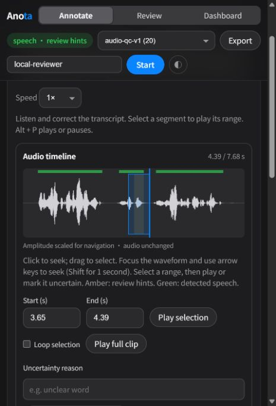

# 音频质检 v1：集成验证与交接

2026-10-17，Windows / Python 3.12.10。本记录覆盖 Anota 集成与交接状态；冻结工程测量见 [RESULTS.md](../runs/2026-10-17-audio-qc-v1/RESULTS.md)。[机器验证记录](audio-qc-v1-integration.json)保存命令、结果、最终源码哈希和演示 manifest 哈希。没有覆盖测量时的源码快照。

## 交付范围

- 独立 `speechqc` Python API/CLI：DSP、逐声道 Silero VAD、转录时间覆盖、内容寻址缓存和严格版本化报告；不依赖 Anota 数据库或 Web 框架。
- Anota：离线报告导入、音频/转录哈希核验、波形拖动选区、键盘定位、区间/循环播放、疑点和词/片段回听、听不清区间及草稿恢复。
- 批次隔离：基础波形在两种条件均可使用；盲审批次从服务器响应去掉机器疑点和 VAD。导入不能改变已有批次的提示策略。
- 审计：原始 ASR 和分析报告保留，人工修订追加保存。数据库迁移仅增加 `review_context`。导出记录报告身份、提示可用/展示状态及成功开始播放的疑点 ID；播放不等于听完，更不等于确认疑点。
- 失败：VAD 不可用时保留 DSP 和部分状态；分析失败保留脱敏显示与服务端失败溯源，不伪造正常结果。Web 进程只导入标准库报告校验代码，不加载音频模型。

## 验证结果

| 检查 | 结果 |
| --- | --- |
| 修改前全项目基线 | 173 passed，17.21 s |
| 完成后全项目回归 | 230 passed，30.21 s |
| 最终评测脚本兼容性修改后的定向检查 | 10 passed，0.27 s |
| JavaScript 语法、Git whitespace | 通过 |
| 冻结实验文件 SHA-256 | 17/17 匹配 |
| 最终源码新缓存重新分析原始录音 | 20/20 complete；信号指标、VAD、覆盖、波形和疑点与冻结原始条件逐条一致 |
| 最终审核库导入 | 20 条，0 失败、0 无效；交接时人工修订为 0 |

核心分析测试使用可控 VAD 替身验证区间和边界；冻结实验另执行真实 Silero VAD。API 测试覆盖报告篡改/输入变更、盲审与提示批次、提交和撤销、导出、伪造播放 ID、旧客户端未知遥测，以及失败信息不泄露到标注页面。静音报告 fixture 只用于契约测试，不是质量评估证据。

逐条比较时发现一处表示差异：评测脚本把 `max_duration_s` 保存为整数 `1800`，CLI 默认保存为浮点数 `1800.0`，数值和限制相同。报告哈希对 JSON 字节表示敏感，因此两组 `analysis_id` 不同。其余字段相同；机器记录保留两组身份，不能声称文件或完整报告哈希一致。此处没有重写冻结数据或已导入任务。

浏览器验证使用独立的 `runtime/audio-qc-v1/ui-test.db`。测试标注带有 `AUTOMATED UI TEST` 说明，不能混入人工评估。实际验证了：0.5–1.0 秒选区播放在末端停止、循环和 Alt+P 暂停、拖动选区、草稿刷新恢复、标记听不清区间、疑点 3.85–4.19 秒带上下文回听 3.65–4.39 秒、成功播放 ID 入库、切换页面暂停、追加式撤销，以及盲审批次无提示。466 px 窄屏布局经过截图检查。该测试服务已停止。



截图中的波形仅为导航按峰值缩放，音频增益和 DSP 数值未改动。截图是自动化功能演示，未形成听音质量标签。交接页面已刷新，播放日志从新的审核会话开始。

## 本机审核入口

[打开工作台](http://127.0.0.1:8422/?batch=1)，批次 `audio-qc-v1`，20 条英语/普通话录音。页面已打开，当前身份为 `local-reviewer`；可以改成自己的标注身份再点 Start。服务运行于独立数据库，不覆盖原语音实验或其他端口服务。

若服务停止，在 Anota 根目录重新启动已有审核库：

```powershell
.venv\Scripts\python.exe run.py --db runtime/audio-qc-v1/release/review.db --port 8422 --export-dir runtime/audio-qc-v1/release/exports
```

已有库包含全部导入任务，重启无需重复分析或导入。日志和本次进程 ID 保存在 `runtime/audio-qc-v1/release/`。原始音频仍位于语音准备流水线的数据目录；不要移动音频后继续使用旧注册路径。

从头分析/新建批次的命令与拆仓接口见 [设计文档](../../docs/audio-qc-v1.md)。开发过程曾产生早期原型缓存；正式入口使用独立的 `release/cache`，本次报告已与冻结实验原始条件逐条比较。

## 下一步审核与扩展

原始 20 条有 16 条收到至少一个提示，尚未人工裁定。先使用 [待审核表](../runs/2026-10-17-audio-qc-v1/human-audit-template.csv)复制出新的审核记录，按类别回听并随机抽检无提示区间，评估提示负担；不把待审核表里的 `pending` 改写成未经听音的结果。

之后在独立开发集调阈值，在冻结测试集上比较“播放器 / 波形与循环 / 加质检提示”。LLM、多 ASR 和学习排序作为独立证据来源加入，分别记录身份、输入、状态、耗时和增益，保留现有原始结果。人类准确率、效率收益、多模型效果目前均未测量。

Docker、Linux/ARM64 CI 和 Python 3.10 实机运行未在本机执行。当前交付是本地第一版，不含 LLM、多 ASR 集成或独立仓库发布。
