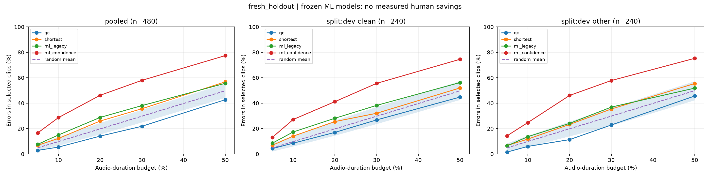
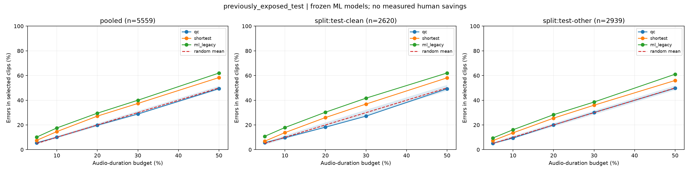

# LibriSpeech 轻量 ML 复核排序 v2

开发数据按说话人分离训练/调参/锁定评测；旧 test 在 v1 已被查看，作为独立于训练的已暴露复用基准。
旧 ASR 未存词/句置信度：test 仅评 legacy 模型；真实置信度来自 dev 的首次转录，holdout 同时比较两组模型。
错误覆盖指选中整录音包含的 S+D+I；预算为音频时长，不是人工耗时。随机区间是 1,000 个固定顺序的波动。

## fresh_holdout

| 分组 | 时长预算 | 方法 | 错误覆盖 | 实际时长比例 | 剩余 WER |
| --- | ---: | --- | ---: | ---: | ---: |
| pooled | 10% | qc | 5.42% | 9.32% | 8.42% |
| pooled | 10% | shortest | 12.26% | 9.96% | 7.90% |
| pooled | 10% | ml_legacy | 14.97% | 9.99% | 7.59% |
| pooled | 10% | ml_confidence | 28.65% | 9.72% | 6.36% |
| pooled | 10% | random mean | 9.78% | 9.84% | 8.13% |
| pooled | 20% | qc | 14.06% | 19.81% | 8.48% |
| pooled | 20% | shortest | 25.94% | 19.95% | 7.52% |
| pooled | 20% | ml_legacy | 28.77% | 19.79% | 7.10% |
| pooled | 20% | ml_confidence | 46.19% | 19.49% | 5.37% |
| pooled | 20% | random mean | 19.76% | 19.84% | 8.13% |
| split:dev-clean | 10% | qc | 8.50% | 9.78% | 6.03% |
| split:dev-clean | 10% | shortest | 14.05% | 9.83% | 5.59% |
| split:dev-clean | 10% | ml_legacy | 17.32% | 9.55% | 5.33% |
| split:dev-clean | 10% | ml_confidence | 27.12% | 9.98% | 4.73% |
| split:dev-clean | 10% | random mean | 9.72% | 9.70% | 5.91% |
| split:dev-clean | 20% | qc | 16.99% | 19.88% | 6.08% |
| split:dev-clean | 20% | shortest | 25.49% | 19.93% | 5.47% |
| split:dev-clean | 20% | ml_legacy | 28.10% | 19.60% | 5.23% |
| split:dev-clean | 20% | ml_confidence | 41.18% | 19.82% | 4.25% |
| split:dev-clean | 20% | random mean | 19.75% | 19.72% | 5.91% |
| split:dev-other | 10% | qc | 5.97% | 9.90% | 10.92% |
| split:dev-other | 10% | shortest | 11.73% | 9.95% | 10.56% |
| split:dev-other | 10% | ml_legacy | 13.65% | 9.82% | 10.20% |
| split:dev-other | 10% | ml_confidence | 24.73% | 9.52% | 8.89% |
| split:dev-other | 10% | random mean | 9.87% | 9.68% | 10.72% |
| split:dev-other | 20% | qc | 11.30% | 19.67% | 11.33% |
| split:dev-other | 20% | shortest | 23.24% | 19.73% | 10.37% |
| split:dev-other | 20% | ml_legacy | 24.09% | 18.47% | 9.94% |
| split:dev-other | 20% | ml_confidence | 46.06% | 20.00% | 7.18% |
| split:dev-other | 20% | random mean | 19.86% | 19.68% | 10.72% |

## previously_exposed_test

| 分组 | 时长预算 | 方法 | 错误覆盖 | 实际时长比例 | 剩余 WER |
| --- | ---: | --- | ---: | ---: | ---: |
| pooled | 10% | qc | 10.06% | 9.98% | 8.53% |
| pooled | 10% | shortest | 14.61% | 9.99% | 8.14% |
| pooled | 10% | ml_legacy | 17.56% | 10.00% | 7.84% |
| pooled | 10% | random mean | 9.99% | 9.99% | 8.62% |
| pooled | 20% | qc | 19.81% | 19.97% | 8.52% |
| pooled | 20% | shortest | 27.15% | 19.99% | 7.81% |
| pooled | 20% | ml_legacy | 29.52% | 20.00% | 7.51% |
| pooled | 20% | random mean | 20.00% | 19.99% | 8.62% |
| split:test-clean | 10% | qc | 9.68% | 9.96% | 5.39% |
| split:test-clean | 10% | shortest | 13.78% | 9.99% | 5.19% |
| split:test-clean | 10% | ml_legacy | 17.89% | 10.00% | 4.92% |
| split:test-clean | 10% | random mean | 10.02% | 9.97% | 5.42% |
| split:test-clean | 20% | qc | 18.17% | 19.98% | 5.48% |
| split:test-clean | 20% | shortest | 25.99% | 20.00% | 5.02% |
| split:test-clean | 20% | ml_legacy | 30.31% | 19.98% | 4.70% |
| split:test-clean | 20% | random mean | 19.98% | 19.97% | 5.42% |
| split:test-other | 10% | qc | 9.37% | 9.96% | 11.77% |
| split:test-other | 10% | shortest | 13.58% | 10.00% | 11.28% |
| split:test-other | 10% | ml_legacy | 16.10% | 9.99% | 10.93% |
| split:test-other | 10% | random mean | 9.99% | 9.97% | 11.83% |
| split:test-other | 20% | qc | 19.97% | 19.92% | 11.63% |
| split:test-other | 20% | shortest | 25.50% | 19.99% | 10.90% |
| split:test-other | 20% | ml_legacy | 28.29% | 19.99% | 10.44% |
| split:test-other | 20% | random mean | 20.00% | 19.97% | 11.83% |

## 证据

- `candidate-trials.json` 保存全部 14 个候选的调参指标和警告；`selected-models.json` 记录选择。
- `model-*.json` / `model-*.joblib` 保存最终特征顺序、训练元数据及模型；只加载可信本地模型文件。
- `evaluation-seal.json` 绑定模型、特征、预测、全部排序/预算计划，在 holdout/test 本轮评分前生成。
- `*-summary.json`、`*-scored.jsonl`、`*-random-trials.jsonl.gz` 保存完整分组、逐条错误与随机明细。
- `confidence-availability.json` 区分真实保存的置信度、缺失字段和常量语言概率。
- `validation.json`、`artifact-hashes.json` 保存完整性校验。原 v1 产物未改写。

方法文档：[冻结协议](../source-snapshot/docs/audio-qc-ml-ranking-protocol-v2.md)。
数据来源：[LibriSpeech](https://www.openslr.org/12/)，CC BY 4.0。
