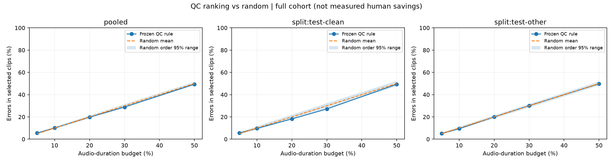
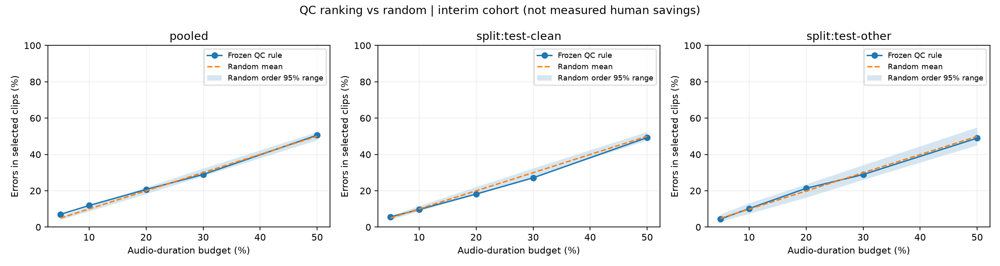

# LibriSpeech QC 排序与随机排序 v1

2026-10-17。用户授权复用现有 ASR 与官方参考，先评已完成固定快照，再自动衔接完整 5,559 条。**不会启动新的 ASR 推理，不按中期结果调整排序规则。**

协议冻结于 `2026-10-17T07:19:07.479598+00:00`。输入、规则、种子、环境和实际 Silero 模型哈希见 [protocol.json](protocol.json)、[config.json](config.json)、[冻结文档](source-snapshot/docs/audio-qc-ranking-protocol-v1.md)及 `source-snapshot/`。[预运行验证](preflight-validation.json)：291 项项目测试通过，目标 Ruff 与 whitespace 检查通过。

## 队列与状态

| 队列 | 范围 | 状态 |
| --- | --- | --- |
| 中期 | 2,959 条：test-clean 2,620，test-other 339；40/5 位说话人 | 已完成，`2026-10-17T07:27:11.124403+00:00` |
| 全量 | 5,559 条：test-clean 2,620，test-other 2,939；40/33 位说话人 | 已完成，`2026-10-17T07:48:17.689467+00:00` |

中期固定快照共 21,671.7555 秒；尚未完成的 2,600 条共 17,010.29525 秒未进入中期分母。中期不是随机样本，不能外推为全量结果。各 worker 分别通过只读 SQLite 事务捕获；精确捕获时间与快照哈希见 `cohorts/interim/inputs.json`。

所有方法共用“整录音最长前缀、首条超预算即停止”选择器，以音频时长作为预算。主结果看 10%/20%，附加 5%/30%/50%/100% 曲线。随机基线为 1,000 个固定种子；其分位区间是随机顺序波动，不是泛化置信区间。报告所选录音包含的错误，不宣称人已经找到或修正这些错误。

## 全量结果与解释

**全量结果未显示当前 QC 排序比随机排序有稳定的错误筛选收益。** 原 ASR 在 `07:44:34 UTC` 完成，续接器自动验证并使用全部 5,559 条结果，没有重复调用 ASR。全量共 38,682.05075 秒、104,919 个参考词、9,044 个 S+D+I 错误，整体 WER 8.62%；ASR 与 QC 均无失败，所有录音均进入分母。

| 分组 | 目标时长预算 | QC 错误覆盖 | 随机均值（95%顺序范围） |
| --- | ---: | ---: | --- |
| 全部 5,559 条 | 10% | 10.06% | 9.99%（9.09%–10.99%） |
| 全部 5,559 条 | 20% | 19.81% | 20.00%（18.68%–21.24%） |
| test-clean，2,620 条 | 10% | 9.68% | 10.02%（8.52%–11.54%） |
| test-clean，2,620 条 | 20% | 18.17% | 19.98%（17.99%–21.96%） |
| test-other，2,939 条 | 10% | 9.37% | 9.99%（8.90%–11.13%） |
| test-other，2,939 条 | 20% | 19.97% | 20.00%（18.62%–21.41%） |

所有主预算 QC 结果均在对应随机顺序的 95% 范围内。pooled 的 QC 实际用量是 9.98% / 19.97%（3,859.83 / 7,723.23 秒），选中 553 / 852 条，包含 910 / 1,792 个错误；剩余 WER 是 8.53% / 8.52%。使用未舍入值计算的 QC 与随机差值为 +0.07 / −0.18 个百分点。

相比中期 11.90% / 20.69% 的错误覆盖，全量为 10.06% / 19.81%，中期 10% 预算的小幅增益没有延续。test-clean 在中期已经齐全，因此该 split 的独立排序指标完全一致；test-other 从 339 条扩大到 2,939 条后，不再显示高于随机均值的主预算结果。这与中期“不足以支持大幅减少人工”的结论一致，并削弱了对 v1 排序增益的期待。

全部预设条件的 pooled 结果如下；主条件始终为完整 QC，未按中期结果改变任何规则：

| 排序条件 | 10% 时长预算错误覆盖 | 20% 时长预算错误覆盖 |
| --- | ---: | ---: |
| 完整 QC（主条件） | 10.06% | 19.81% |
| DSP 特征消融 | 9.77% | 19.77% |
| 覆盖检查特征消融 | 9.76% | 18.83% |
| 最短录音优先 | 14.61% | 27.15% |
| 最长录音优先 | 7.71% | 16.12% |
| 随机均值 | 9.99% | 20.00% |

最短录音优先仍高于随机，但选中 1,405 / 2,344 条，比 QC 多得多；尚未测量每条录音的切换、定位和修正开销，因此不能直接转化为人工成本节省，也没有据此修改产品默认排序。评分后描述性检查显示，4,638 条没有 QC issue 的录音仍含 7,014 / 9,044 个错误（77.55%）；计算方法与下方中期检查一致。这再次说明没有声学/时间覆盖提示不能保证转录正确。

这项结果针对 v1 的整录音 ASR 错误排序能力。波形导航、音质问题发现和疑点回听的定位价值不由本次 WER 排序实验直接衡量。下一轮应在独立开发数据上验证额外的 ASR 置信度、异常特征或学习排序，保留 v1 作为基线；不能继续在已查看的 test 结果上选择规则后声称独立验证。

[全量报告与分组曲线](cohorts/full/RESULTS.md) · [全部指标](cohorts/full/summary.json) · [运行校验](cohorts/full/validation.json) · [产物哈希](cohorts/full/artifact-hashes.json)

全量独立审计 **87 项检查全部通过**：[审计记录](../../reviews/librispeech-qc-ranking-v1-full-audit.json)、[审计脚本精确副本](../../reviews/librispeech-qc-ranking-v1-full-audit-source.py)。核对全部 5,559 条原音频哈希、目标/快照/上游合并结果的 ID 与完成身份、冻结产物、逐条编辑距离及 QC 分数，并独立重建所有方法与全部随机种子的选择计划。没有改动中期或全量的封存产物。

## 中期结果与解释（保留当时记录）

**目前主 QC 排序的增益有限，不支持“大幅减少人工复核”的结论。** 本次复用 2,959 条 ASR，新增 ASR 调用为 0；全部 QC 正常完成，没有失败优先层级贡献收益。共有 57,969 个参考词、3,774 个 S+D+I 错误，总体 WER 6.51%。

| 目标时长预算 | QC 实际用量 | QC 选中条数 | QC 覆盖错误 | 随机均值（95%顺序范围） | 相对随机差值 |
| --- | ---: | ---: | ---: | --- | ---: |
| 10% | 9.95%，2,156.89 秒 | 316 | 449 / 3,774 = 11.90% | 10.00%（8.58%–11.42%） | +1.90 个百分点 |
| 20% | 19.99%，4,333.14 秒 | 484 | 781 / 3,774 = 20.69% | 19.99%（18.12%–21.78%） | +0.71 个百分点 |

10% 的 pooled QC 结果高于随机顺序的 97.5% 分位；20% 位于该范围内。这是当前固定队列上的描述，未做泛化显著性推断。独立在 test-clean 内排序时，两预算的 QC 错误覆盖率是 9.68% / 18.17%，低于随机均值 10.02% / 19.98%；test-other 内为 10.18% / 21.34%，随机为 9.87% / 19.87%。**test-other 只有 339 条、5 位说话人，全量结论仍待后续结果。** 各组分别重新排序和分配预算，不是从 pooled 选择结果切片。

全部预设附加条件均保留，以下为 pooled 的错误覆盖率；不将较好的附加条件改称主结果：

| 排序条件 | 10% 时长预算 | 20% 时长预算 |
| --- | ---: | ---: |
| 完整 QC（主条件） | 11.90% | 20.69% |
| DSP 特征消融 | 10.70% | 21.20% |
| 覆盖检查特征消融 | 10.17% | 19.05% |
| 最短录音优先 | 15.45% | 28.64% |
| 最长录音优先 | 7.92% | 15.61% |
| 随机均值 | 10.00% | 19.99% |

“最短优先”在这个中期队列中更好，但对应 766 / 1,265 条录音，显著多于 QC 的 316 / 484 条；本轮没有测量切换录音、定位和纠错的固定开销，因此不能将其音频时长优势等同于人工节时，也不据此修改默认排序。

评分后描述性检查：2,420 条录音没有 QC issue，它们仍含 2,842 / 3,774 个错误（75.30%）；总体 2,972 个错误是替换（78.75%）。计数直接来自 `cohorts/interim/scored-items.jsonl`：按 `not row['issues']` 过滤后求条数和 `errors` 和，替换数取所有 `substitutions` 和。这说明当前声学/时间覆盖提示不能当作文字正确性的保证；这些描述不构成新的调参规则。

后续研究候选：在独立开发集上验证现有 ASR 可提供的置信度与异常特征、轻量错误风险排序，再考虑多模型分歧或 LLM 特征。新特征须记录额外计算成本，并在未用于规则选择的数据上评估。已查看的本次 test 结果不能再充当下一轮独立调参验证集。当前全量实验仍沿用 v1，不调整权重、阈值或随机种子。

[完整主结果和分组曲线](cohorts/interim/RESULTS.md) · [全部指标](cohorts/interim/summary.json) · [运行校验](cohorts/interim/validation.json) · [产物哈希](cohorts/interim/artifact-hashes.json)

独立审计 **81 项检查全部通过**：[审计记录](../../reviews/librispeech-qc-ranking-v1-interim-audit.json)、[原审计实现的字节一致副本](../../reviews/librispeech-qc-ranking-v1-interim-audit-source.py)。审计使用独立标准库实现，复算全部录音的编辑距离/QC 分数、所有方法和 1,000 个随机种子的完整选择计划，以及主预算指标；随机 gold 指标抽查 4 个固定种子。审计正确性不代表效果或泛化成立。原脚本的输入/输出路径固定于本次研究，复验须另设输出位置，保留原记录。

## 产物位置与续接

中期报告保存于 `cohorts/interim/RESULTS.md`；全量保存于独立的 `cohorts/full/RESULTS.md`，未覆盖中期。每个 cohort 保存汇总、完整压缩 QC 报告、逐条评分、随机试验、gold 前封存的排序与预算计划、图表、验证和产物哈希。

完整输入副本及分析缓存保存在本机 `runtime/audio-qc-ranking-v1/`，没有上传或重复下载音频。原 ASR 完成后，后台续接器已验证合并结果与全部 ID，并执行相同冻结代码。状态与日志：

- `runtime/audio-qc-ranking-v1/full-followup-status.json`
- `runtime/audio-qc-ranking-v1/full-followup.stdout.log`
- `runtime/audio-qc-ranking-v1/full-followup.stderr.log`

全量核验完成后，当前聊天的 `librispeech-qc` 跟进已设为 `PAUSED`，避免重复通知。后台续接器正常完成并退出。重现命令及失败处理见 [运行说明](../../../docs/audio-qc-ranking-runbook.md)。新实验或源码/环境变更应另建研究目录，不能覆盖已封存输入和结果。

来源：[LibriSpeech / CC BY 4.0](https://www.openslr.org/12/)。官方参考不是 Anota 新产生的人工标签。原始音频、预测与参考均保留。
